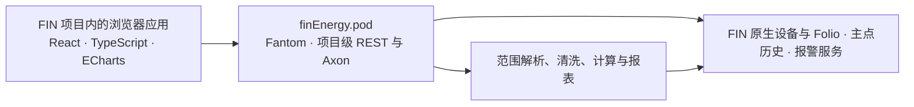
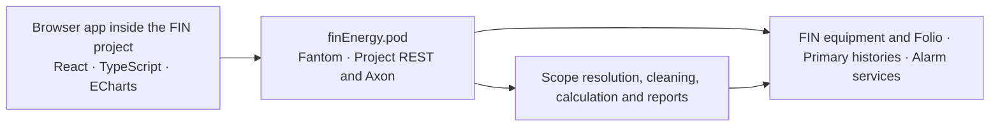

# FIN 能源管理 / FIN Energy

[中文](#中文) · [English](#english)

## 中文

**FIN 能源管理**是面向存量改造和新建项目的 FIN Framework Pod。它在原有 FIN 项目中复用设备、主能耗点历史和报警服务，让运营人员从空间、计量和组织等角度分析楼宇用能，并追溯结果的来源与质量。

### 产品功能

| 功能 | 当前能力 |
| --- | --- |
| 经营驾驶舱 | 按 FIN 项目时区查询，本月为默认范围。支持今日、本年及自定义范围，以及同比、环比对照。首页显示空间、指标、趋势与核查线索，时间、用途、组织、计量平衡和效率视角按需加载。支持预算参照，预算与费用口径满足要求时计算正式偏差。 |
| 分析工作台 | 查看能耗概况、日均负荷、工作时段、多点趋势、排名、占比、分项能耗、能流和总分表差额。根据报表选择时间或对象对比、参考曲线、预测、费用、单位面积指标、COP 或标准煤和碳排放折算。 |
| 项目配置 | 管理计量资产、能源分类与分项、费率、日历、公式、预算及核查规则。可在应用中编辑楼宇和楼层面积并保存到 FIN 原生 `area` 标签。 |
| 清洗与覆盖 | 读取时应用配置的过滤、替代或已知周期的回卷修正规则。诊断保留主点、覆盖情况和处理依据。 |
| 报警与消息 | 按启用条件和具备完整历史的小时区间检查能耗阈值。持续超限合并为事件并与 FIN 原生报警同步。消息中心分页呈现报警和配置变更，按需读取逐小时报警明细并支持确认。 |
| 报表与导出 | 可保存查询模板并从驾驶舱下钻。工作台支持 Excel、Word、分页 PDF 和打印。Excel、Word 和 PDF 包含报表结果中的完整明细，PNG 提供图表与摘要。 |

界面支持中文、英文和手机布局。应用默认跟随 FIN 用户语言，支持手动切换。原生启动菜单跟随 FIN 用户语言。设备名称和用户输入保留原文。

### 架构与数据口径



- FIN 负责采集、原始历史存储、项目身份与权限。Pod 负责项目配置与分析，按 FIN 授权读取历史并生成结果。
- 物理表和虚拟表均使用各自明确绑定的主能耗点。统计按当前生效的空间、计量或组织关系解析，识别重叠计量范围。结果区分实测量、替代值、零值、缺测和 NA。
- 驾驶舱保留首页快照，并按需读取其他视角。读取时核对统计范围、查询截止时间和配置版本。符合条件的驾驶舱查询支持后台执行和取消。工作台默认查询完整报表，导出以所使用的报表快照为准。
- 主要源码在 [Fantom 后端](finEnergy.pod/fan)、[前端](finEnergy.pod/ts/src) 和[发行版实现](finEnergy.pod/editions)。REST 根路径为 `/api/{project}/ext/finEnergy/v1`，Axon 函数使用 `finEnergy*` 前缀。

### 中国版与总部版

当前源码版本为 **0.16.12**，两版共享业务功能和版本号。授权方式由构建时的发行版决定。

| 项目 | 中国版 `China` | 总部版 `HQ` |
| --- | --- | --- |
| 授权 | 实例级独立签名产品授权，支持机器绑定或限时培训 | FIN 原生许可证必须包含精确的功能标识 `finenergy` |
| 未获有效授权 | 每项目可使用 10 块纳管表，电表和水表等共用额度。超额时暂停相关查询和后台计算，保留减额和授权管理入口 | 扩展由 FIN 原生许可检查控制启用 |
| 管理入口 | 「授权管理」查看额度和期限，FIN 超级用户导入或删除产品授权 | 在 FIN **Host → Licenses** 管理，应用授权页显示原生状态 |
| 包内标识 | `china` / `selfManaged` | `hq` / `finNative` |

两个发行包同名 `finEnergy.pod`，部署时按许可证选择一个。更多细节见[双语授权说明](docs/finenergy-licensing.md)。

### 安装、构建与验证

**构建和 SDK 测试基线为 FIN 5.3.0.2761。** 管理员按目标实例的备份和停机流程，将所选发行包安装到 FIN 的 `lib/fan` 目录，再启动 FIN 并启用扩展。新项目在应用中纳入设备并绑定已采集历史的主能耗点。既有 EnerCubix 项目应按[升级与回滚指南](docs/finenergy-upgrade.md)先预览迁移、检查冲突和备份，再切换扩展与任务。指南中的 0.16.0 入口是迁移示例，实际入口以 FIN 应用菜单所加载的版本为准，授权按上表选择。

运行已构建的 Pod 使用 FIN 自身的运行环境。源码构建需要匹配的 FIN SDK、Java、Node.js 和 npm。以下命令在仓库根目录的 Windows PowerShell 中执行。将示例路径替换为自己的 SDK 和获准使用的 RSA **公开验签密钥**文件。总部版使用 FIN 原生许可。

```powershell
$finSdk = 'C:\Program Files (x86)\FIN\FIN 5.3.0.2761'
$publicKeyring = 'C:\path\to\approved-license-keys.json'
npm --prefix finEnergy.pod/ts ci
node scripts/check-versions.mjs
.\scripts\build.ps1 -Edition HQ -SdkPath $finSdk
.\scripts\build.ps1 -Edition China -SdkPath $finSdk -LicenseKeyring $publicKeyring
.\scripts\test.ps1 -Edition HQ -SkipBuild
.\scripts\test.ps1 -Edition China -SkipBuild
```

默认输出到 `out/hq/finEnergy.pod` 和 `out/china/finEnergy.pod`。每个发行目录包含验包结果和构建回执。构建使用独立的 SDK 副本，构建与测试结束后再按目标环境流程安装。

**验证状态**。0.16.12 两版均通过构建与验包。中国版已有 0.16.11 的 FIN 实机记录。总部版 0.16.12 的有效授权激活待真实 FIN 测试许可证。性能记录对应具体样本和环境。Linux、Desigo Optic 与其他 FIN 构建以目标环境验收为准。详见[构建与验收记录](docs/team/board.md)。

### 文档与分支

- [文档索引](docs/CURRENT.md) · [架构设计](docs/finenergy-architecture-design.md) · [API 与 Axon 契约](contracts/api.zh-CN.md)
- [系统要求](docs/finenergy-system-requirements.md) · [升级与回滚](docs/finenergy-upgrade.md) · [驾驶舱需求](docs/finenergy-cockpit-requirements.md)

`developer` 是开发与集成分支，`main` 用于稳定发布。

## English

**FIN Energy** is a FIN Framework Pod for building energy analysis in retrofits and new projects. It reuses the equipment, primary meter-point histories and alarm services in an existing FIN project so operators can analyze energy use by space, metering and organization and trace the source and quality of each result.

### Product capabilities

| Area | Current capabilities |
| --- | --- |
| Operations cockpit | Queries use the FIN project time zone and default to the current month. Supports today, this year and custom ranges, plus year-over-year and month-over-month comparisons. The home view shows space, indicators, trends and review findings. Time, end use, organization, metering balance and efficiency views load on demand. The cockpit provides budget reference figures and calculates formal variance when the budget and cost coverage meet the comparison criteria. |
| Analysis workspace | View consumption profiles, average daily load profiles, working periods, multi-point trends, rankings, shares, end uses, energy flows and meter-balance differences. Depending on the report, use time or object comparisons, reference curves, forecasts, costs, area intensity, COP, standard coal or carbon conversions. |
| Project configuration | Manage metering assets, energy categories and end uses, tariffs, calendars, formulas, budgets and review rules. Edit building and floor areas in the application and save them to FIN's native `area` tag. |
| Cleaning and coverage | Apply configured filtering, substitution or known rollover correction when reading history. Diagnostics retain the primary point, coverage and the basis for the treatment. |
| Alarms and messages | Check enabled hourly consumption thresholds for intervals with complete historical data. Consecutive exceedances are grouped into events and synchronized with FIN native alarms. The message center paginates alarms and configuration changes, loads hourly alarm details on demand and supports acknowledgement. |
| Reports and exports | Save query templates and drill into reports from the cockpit. The workspace supports Excel, Word, paginated PDF and printing. Excel, Word and PDF include the full detail in the report result. PNG output contains charts and summaries. |

The UI supports Chinese, English and mobile layouts. The application follows the FIN user's language by default and allows manual switching. The native launcher follows the FIN user's language. Device names and user input retain their original text.

### Architecture and data rules



- FIN owns acquisition, raw history storage, project identity and permissions. The Pod manages project configuration and analytics, reads permitted history and produces results.
- Physical and virtual meters use their own explicitly assigned primary points. Queries resolve current space, metering or organizational relationships and identify overlapping metering boundaries. Measured consumption, substitutions, zero, missing data and NA are kept distinct.
- The cockpit retains its home snapshot and loads other views on demand. Queries check the scope, cutoff and configuration version. Eligible cockpit queries can run in the background and be cancelled. The workspace requests a full report by default. Exports use the selected report snapshot.
- Main source paths are the [Fantom backend](finEnergy.pod/fan), [web application](finEnergy.pod/ts/src) and [edition implementations](finEnergy.pod/editions). The REST base is `/api/{project}/ext/finEnergy/v1`. Axon functions use the `finEnergy*` prefix.

### China and HQ editions

The current source version is **0.16.12**. Both editions share product capabilities and the version number. Licensing is selected at build time.

| Area | China `China` | HQ `HQ` |
| --- | --- | --- |
| Licensing | Independently signed instance-wide product license, with machine-bound and time-limited training options | Native FIN license with the exact feature ID `finenergy` |
| Without a valid license | Ten enrolled meters per project across energy types. Over-quota projects pause related queries and jobs and retain access for reducing enrollment or managing the license | FIN's native licensing check controls whether the extension is enabled |
| Administration | View limits and dates in License management. A FIN superuser imports or removes the product license | Manage licensing in FIN **Host → Licenses**. The application shows native license status |
| Pod metadata | `china` / `selfManaged` | `hq` / `finNative` |

Both packages are named `finEnergy.pod`. Install the edition that matches the intended license. See [bilingual licensing](docs/finenergy-licensing.md) for details.

### Installation, build and verification

**The build and SDK test baseline is FIN 5.3.0.2761.** Follow the target instance's backup and shutdown procedure, install the selected Pod in FIN's `lib/fan` directory, then restart FIN and enable the extension. For new projects, enroll devices in the application and bind primary energy points with history. For projects replacing EnerCubix, use the [upgrade and rollback guide](docs/finenergy-upgrade.en.md) to preview migration, check conflicts and back up the instance before switching extensions and jobs. The 0.16.0 URL in the guide illustrates the migration. Open the installed version from the FIN application menu and follow the licensing rules for your edition above.

The built Pod runs in the FIN runtime. Source builds require the matching FIN SDK, Java, Node.js and npm. Run the following commands in Windows PowerShell from the repository root. Replace the sample paths with your SDK and an approved RSA **public verification keyring**. HQ uses native FIN licensing.

```powershell
$finSdk = 'C:\Program Files (x86)\FIN\FIN 5.3.0.2761'
$publicKeyring = 'C:\path\to\approved-license-keys.json'
npm --prefix finEnergy.pod/ts ci
node scripts/check-versions.mjs
.\scripts\build.ps1 -Edition HQ -SdkPath $finSdk
.\scripts\build.ps1 -Edition China -SdkPath $finSdk -LicenseKeyring $publicKeyring
.\scripts\test.ps1 -Edition HQ -SkipBuild
.\scripts\test.ps1 -Edition China -SkipBuild
```

The default outputs are `out/hq/finEnergy.pod` and `out/china/finEnergy.pod`. Each edition directory holds its package verification and build receipt. Builds use an isolated SDK copy. After building and testing, install through the target environment's deployment process.

**Verification status.** Both 0.16.12 editions passed build and package checks. A FIN runtime record is available for China 0.16.11. HQ 0.16.12 activation with a genuine FIN test license is pending. Performance records apply to the tested data and environment. Linux, Desigo Optic and other FIN builds require verification on the target environment. See the [build and verification record](docs/team/board.md).

### Documentation and branches

- [Documentation index](docs/CURRENT.md) · [Architecture](docs/finenergy-architecture-design.en.md) · [API and Axon contract](contracts/api.md)
- [System requirements](docs/finenergy-system-requirements.en.md) · [Upgrade and rollback](docs/finenergy-upgrade.en.md) · [Cockpit requirements](docs/finenergy-cockpit-requirements.en.md)

`developer` is the development and integration branch. `main` is used for stable releases.
