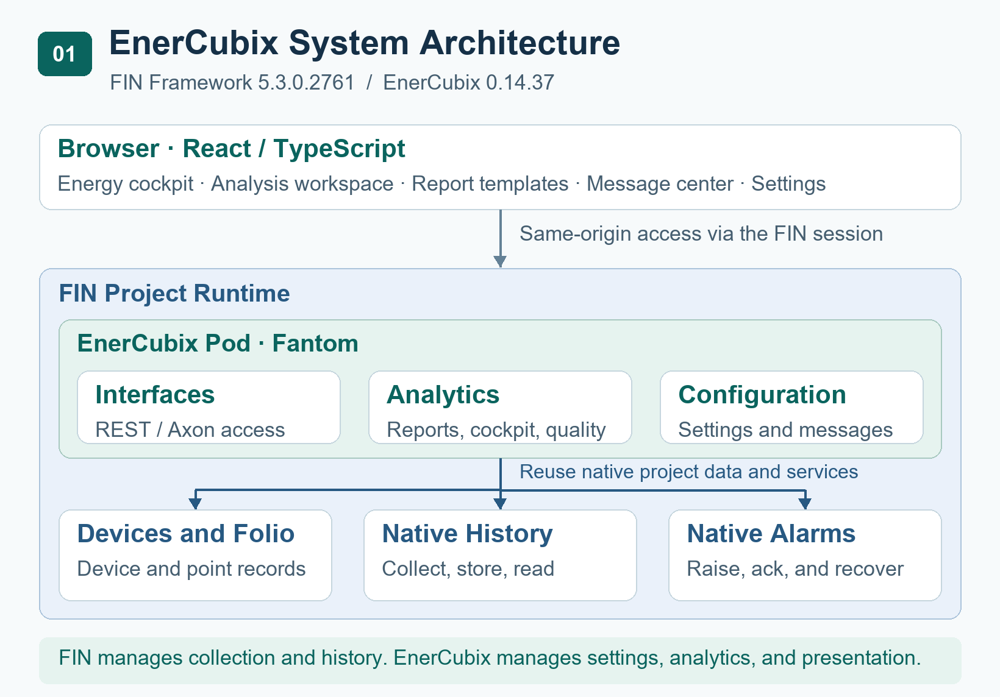
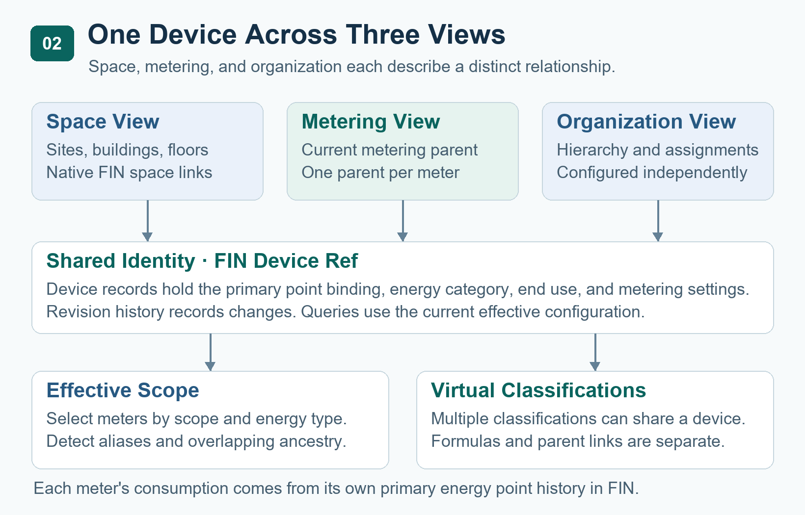
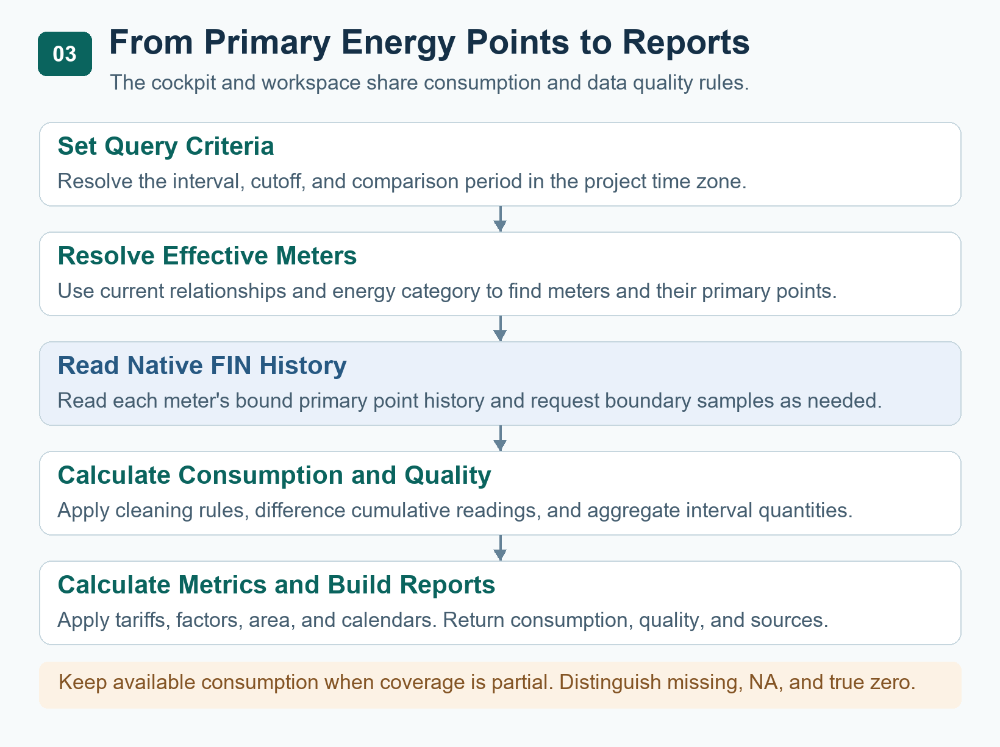
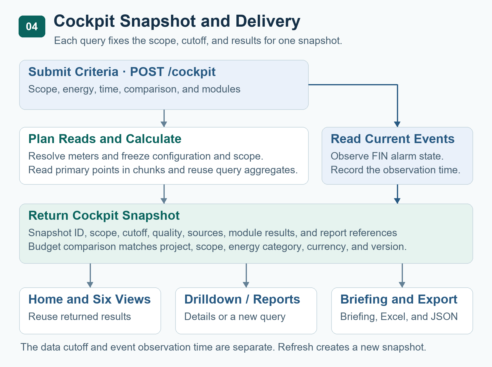
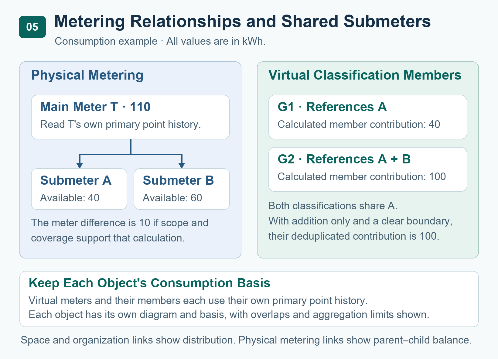

# EnerCubix Software Architecture and Detailed Design

**EnerCubix · ECX-SDD-001 · Document version 2.0 · 2026-11-11**

[简体中文](enercubix-architecture-design.md)

This document covers EnerCubix **0.14.37** on FIN Framework **5.3.0.2761**. It explains how device consumption flows from FIN history into reports, the cockpit, and exports. It also defines where configuration, current-value calculations, and alarms can write data. It is intended for developers, implementation engineers, and acceptance testers. For HTTP and Axon contracts, see the [API documentation](../contracts/api.md).

| Baseline | Evidence |
| --- | --- |
| Code and interfaces | Commit `73a391ac` on `developer`. The branch was synchronized with GitHub. |
| Installed code | The local delivery on 2026-11-05 used commit `92404a33`. Commit `73a391ac` records the delivery. |
| Product scope | Energy analytics for buildings and campuses. Costs use configured tariffs and support operational comparison and budget tracking. |
| Document history | This edition supersedes the 2026-10-24 architecture document for version 0.8.6. Runtime evidence is recorded in the [0.14.37 delivery record](../specs/cockpit-parity-20261101/final-handoff-01437.md). |

## 1 System Architecture

EnerCubix runs in the FIN process as a single `enerCubix.pod`. FIN provides project context, user identity, device records, point history, connectors, and alarm services. Within the same project, EnerCubix manages energy configuration, reads native history for the requested scope, and produces analytics and exports. The source of record for consumption is the **history of the primary energy point** explicitly bound to each device.

| Layer | Main entry points and responsibilities |
| --- | --- |
| Frontend | `enerCubix.pod/ts/src`. React and TypeScript implement the overview, analysis workspace, templates, message center, and settings. Pages keep draft criteria and render the returned data after a successful query. |
| FIN extension and interfaces | `EnerCubixExt` mounts the project entry point and redirects to versioned static assets. `EnerCubixRest` dispatches HTTP routes. `EnerCubixLib` provides Axon entry points. |
| Project access | `EnerCubixRepo` handles the project catalog, devices, and configuration. Adapters for native devices, space, cleaning, and alarms use the FIN context for authorization and data access. |
| Queries and calculations | `EnerCubixHistory` reads and adapts native history. `fan/engine` calculates time buckets, totals, costs, differences, and forecasts. `EnerCubixCockpit` coordinates reports and views within one cockpit request. |
| Deployment assets | `build.fan` defines the Pod version and dependencies. The Pod includes the frontend build, `lib`, `locale`, and static assets. |

The FIN entry point makes same-origin project requests. The authenticated session sets the default language. Each FIN user can save Chinese, English, or Follow FIN as a preference. The application uses `i18n.ts` and its message catalog for page text, and FIN uses localized resources for the native entry point. Project names, device names, and user-supplied names retain their original text.

## 2 Device Identity and Business Relationships

A native device keeps the same FIN Ref in every view. The space view uses native FIN site, floor, and device assignments. The metering view uses the device's single parent reference. Organization membership is configured independently. Formula references on virtual classification meters identify calculation inputs, so multiple classifications can refer to the same member. Queries use the **current configuration** within the user's permissions. Relationship changes are recorded in the message center. The selected historical dates still determine the native history window.

| Object | Storage and lifecycle |
| --- | --- |
| Native devices and points | Reuse FIN Refs, device names, native space assignments, and history. The device's `enerCubix*` tags hold the primary point, metering parent, end use, energy category, organization, and other application attributes. |
| Business configuration | The project Folio stores organizations, energy categories, tariffs, factors, cleaning profiles, and templates. Cockpit budgets, review rules, and assets are also maintained per project. |
| Reports and cockpit | Query results include the effective scope, calculation basis, and data quality. The browser can retain the successful result for presentation and export. FIN retains native history. |
| Existing history and legacy configuration | Compatibility and safeguards remain in place for legacy references and history. Removing a device from the application, editing configuration, and migrating records each have an explicit entry point. Ordinary queries are read-only. |

A space, organization, or metering selection first resolves the accessible devices and the effective calculation boundary. Base consumption is directly comparable across views when the effective device set, deduplication rules, time window, data cutoff, energy category, cleaning, and units match. Reports indicate whether results can be added when parent and child scopes overlap, sources are shared, or units differ. Area intensity also retains the area source and denominator. The selected scope determines how overlapping service areas are validated.

## 3 Primary Point History and Analytics Queries

For ordinary reports, `EnerCubixRepo.report` prepares the arguments, catalog, and permissions. `EnerCubixHistory` reads the data and invokes the calculation engine. The history adapter uses the FIN context to check access and read the bound primary point. The engine consumes the prepared inputs. Sources referenced by comparison and energy flow results also undergo visibility checks.

1. **Set the scope.** Interpret start and end times in the project time zone. Intervals include the start and exclude the end, `[from, to)`. The data cutoff limits what this request can observe. Reference periods declare their own bounds and comparability.
2. **Read history.** Measured meters, physical main meters, and virtual meters each read their own explicitly bound primary point. A main meter with no primary point or no history remains missing. Formula members and direct submeters can supply separate evidence using consumption from their own primary points.
3. **Interpret readings.** For cumulative readings, calculate increments between successive readings. Aggregate interval quantities according to coverage rules. Interpret instantaneous values, power, and reference curves by type. Boundary readings, resets, rollovers, and filtering can affect result quality. Native trends can show the original readings.
4. **Clean and aggregate.** Apply the configured cleaning rules and record filtering, substitutions, and coverage. Calculate consumption after determining the time buckets and device boundary. Apply tariffs and conversion or carbon factors to derive other metrics. Aggregation across sources or units requires a compatible calculation basis.
5. **Present and export.** Charts, details, and exports reuse the successful result. The response distinguishes known subtotals, full-interval values, missing data, NA, true zero, and substituted readings. The latest observed sample timestamp identifies source provenance. Coverage separately determines interval completeness.

Derived minute archives and segmentation by historical relationship dates belong to earlier designs. Current reports use primary point history and the current configuration. `EnerCubixMeterGeneration` retains compatibility entry points. Its `update` and `ensure` operations are disabled, and its publish and recompute entry points reject calls. With partially missing history, available readings can still be shown. Full consumption, differences, and comparisons each have their own quality requirements.

## 4 Cockpit and Snapshots

`POST /cockpit` passes the scope, energy category, time, comparison, and requested modules to the cockpit orchestration layer. Changing focus uses the current snapshot. Applying criteria, rerunning the same criteria, or running an enabled auto-refresh can create a new snapshot. Auto-refresh uses the applied criteria. Time selections include today, this month, this year, and a custom range. The response includes actual comparison bounds, the project time zone, and adjustments for month-end or daylight saving time.

| Stage | Design |
| --- | --- |
| Boundary and cutoff | Resolve the effective devices and primary points. Freeze the actual interval, configuration fingerprint, and data cutoff for the request. A repeat query at the same cutoff can still see late data or configuration updates. |
| Bounded preparation | Read primary points in chunks and prepare time buckets, coverage, cleaning, and diagnostic summaries within the request. Views and related reports reuse these results. The server returns explicit errors when reads, concurrency, duration, or response size exceed their limits. |
| Module assembly | Metrics, space, trends, time, end use, organization, meter balance, efficiency, and items for review form one snapshot. Each module provides status, reasons, and related reports. An isolated module failure can leave other successful results available. |
| Interaction and export | Switching among the six views can reuse available results. The executive briefing, Excel, JSON, and print view use the result frozen by the frontend. An independent query can retrieve hourly evidence, and returning can restore the original snapshot. |

The cockpit selects the budget that matches the calculation boundary, energy category, month, and currency. It uses the configured distribution to calculate the period budget at the cutoff. It calculates formal variance when costs are complete and comparable. With incomplete cost coverage, it shows labeled reference variance and reference budget utilization only when their respective conditions are met. Calendar progress can appear separately. Budget pressure signals require a valid formal comparison. After-hours signals use the configured calendar, thresholds, and valid coverage.

Items for review use current event observations and data quality evidence. Current event status and the cutoff for historical statistics are reported separately. Acknowledgment and recovery are independent states. An acknowledged event that has not recovered is still ongoing. The message center locates existing events using stable identifiers.

## 5 Analytics Modules

| Module | Design and result boundaries |
| --- | --- |
| Trends and load | Distinguishes native trends, periodic consumption, intraday load, and reference curves. Aggregation and charting use the project time zone. Complete and incomplete local days are handled separately. |
| Breakdown and ranking | Produces end-use breakdowns, shares, and rankings within the selected scope. Ordinary end-use reports resolve eligible meters using their own rules. The cockpit breakdown uses the cockpit's effective scope. |
| Comparison | Calculates the baseline and target periods using matching conditions. Supports applicable time alignment and object comparisons. A rate of change requires a valid reference and a nonzero denominator. |
| Efficiency and conversion | Uses consumption, area, tariffs, and applicable factors. COP is total output divided by total input within the same effective coverage boundary. Missing configuration and zero denominators return a reason. |
| Leakage and meter difference | Displays main meter consumption on the left and the stack of available submeter consumption on the right. A participating submeter with missing data leaves other submeters' values available. A difference between the known totals is available when both sides have values, with a ratio when the main meter value is nonzero. Full-interval differences and leakage assessments check coverage, boundary, and sources separately. |
| Energy forecasting | Separates historical training, testing, and forecast periods. Model selection depends on available data. Insufficient history or valid samples return a status and reason. Forecast consumption and estimated cost remain separate from actual history. |

An ordinary report uses `ReportRequest` to pass the report type, dimension, object, time window, granularity, and metric. A request for one meter's daily consumption over a week can use `kind=profile`, `dimension=metering`, `period=day`, and `metric=energy`, with the object's Ref from the catalog. The response contains time-series data in `series`, calculation details in `rows`, totals by object in `summary`, and report-specific evidence in `extra`. The same successful result can be used for export and review.

Raw trends are useful for checking timestamps and readings recorded by FIN. Periodic consumption is useful for checking usage within the selected interval. To investigate a gap for a day, check the designated primary point, interval bounds, and cleaning status. Use coverage and provenance to determine whether the day's consumption is valid. Reference curves provide context and retain their source and sampling basis. Business totals and metering differences use consumption included in the calculation.

### 5.1 Energy Flow and Shared Meters

Energy flow uses a space, organization, or metering view with an explicit scope. Space and organization show energy distribution at the selected level. Metering shows physical parent and child relationships. Virtual classifications show formula references. Selecting multiple objects can return independent diagrams with each diagram's basis, participants, shared sources, and eligibility for aggregation.

In this example, physical main meter T has 110 kWh, and its direct submeters A and B have 40 and 60 kWh. Classification G1 references A, and G2 references A+B. If the primary point histories for the two classifications show 40 and 100 kWh respectively, each classification displays its own history. The classifications share A. When addition-only formula, permission, unit, and boundary requirements are met, the deduplicated contribution from A and B is 100 kWh. The physical main meter still shows its own 110 kWh. The availability of a physical metering difference depends on coverage, metering relationships, and source independence.

Formulas such as `2*A` and `A-B`, aliases of a shared source, nested references, and ancestor overlap each have specific handling. Formulas other than pure addition, and boundaries that cannot be established, retain individual object values and identify aggregation limits. A safely expandable addition-only classification can yield a deduplicated contribution even when shared membership makes its classification values unsuitable for direct addition. Scope-level cost totals use the effective cost-meter boundary. A diagram's contribution references have their own interpretation.

## 6 Interfaces and Permissions

The HTTP base path is `/api/{project}/ext/enerCubix/v1`. Calls use the native FIN session and same-origin requests. All POST requests use FIN's cross-site request protections, and configuration writes also require administrator permissions. JSON responses use the `ok/data` or `ok/error` envelope. Images and entry-point redirects use their respective response types. See the [API documentation](../contracts/api.md) for parameters, error codes, fields, the full route list, and compatibility behavior.

| Purpose | Main HTTP entry points | Access |
| --- | --- | --- |
| Session and catalog | `GET session`, `catalog`, `tree`, `points` | Reads follow the authenticated user's project permissions. |
| Analytics | `POST report`, `cockpit`, `cleaning/preview` | Query or preview. Applicable objects, points, and configuration evidence are read from the project. |
| Metering and configuration | `POST records`, `records/delete`, `tree/manage`, and related routes | Write permissions, input validation, and applicable revision conflict checks. |
| Cockpit configuration | `cockpit/budgets`, `cockpit/rule-profiles`, `cockpit/assets`, and configuration audit | Listing and reading require project permissions. Save, delete, upload, and select operations use the corresponding write routes. |
| Messages and jobs | `GET alarms`, `messages/changes`, `POST alarms/ack`, `tasks` | Reading, acknowledging, and scanning use their respective permissions. |

Axon entry points use the same project repository and calculation paths. `enerCubixReport` runs reports, `enerCubixCatalog` reads the catalog, and `enerCubixInfo` checks the version. Configuration operations such as `enerCubixSaveConfig` and `enerCubixManage` require write access. Engineering acceptance functions follow their own constraints, documented in the API contract.

The backend enforces permissions. Disabled buttons communicate these restrictions in the interface. Configuration updates use the relevant Ref and revision to detect concurrent edits. The server validates relationships, types, and targets. Migration has preview and explicit apply operations, separate from ordinary queries.

## 7 Current Values Alarms and Runtime Safeguards

**Current-value calculations.** `EnerCubixExt` checks periodically and invokes `EnerCubixMeterRollup` according to project configuration. If a device is set to calculate from submeters or has an expression binding, and the target primary point meets ownership and acquisition safeguards, it can update transient current values, status, and required continuity metadata. Measured points backed by acquisition connectors are protected. FIN collects history, and reports continue to read the resulting primary point history in FIN.

**Alarms and messages.** `EnerCubixJobs` manages bounded alarm scans and their enablement. Recurring jobs use native FIN scheduling, and scans use a shared job lock. Alarm logic uses consumption and configured thresholds to create or update native events and retains their acknowledgment and recovery states. Material changes to metering relationships and related settings are logged in the message center. Cockpit queries read relevant events.

**Resource safeguards.** The cockpit limits devices, energy categories, and COP configurations per request. It also limits time span, sample chunk size, cumulative scanned samples, concurrency, duration, and response size. Each project can run up to two concurrent requests, with one per user in that project. The soft target is 20 seconds. Requests use a 30-second server-side check deadline, and serialized responses are capped at 8 MiB. The server reports the reason when a limit is reached. The ordinary analysis workspace retains its own sample limits. Deployment and performance checks record the scope, interval, sample size, and environment.

**Build and deployment.** `node scripts/check-versions.mjs` checks the versions in the root manifest, frontend package and lockfile, and `build.fan`. Build outputs ship with the Pod. Versioned entry points and frontend/backend version checks identify stale cached pages. Local releases follow the team's procedure for checking the previous package backup, candidate package hash, running version, and key interfaces. The delivery record contains package and query evidence.

## 8 Delivery Verification and Traceability

| Verification layer | Recorded results for 0.14.37 |
| --- | --- |
| Source and build | Backend verification covered 122 classes, 1,005 methods, and 300,033 checks. Frontend type checking, the Vite build, and the Pod build passed. All 437 frontend tests passed in a rerun at lower concurrency before the GitHub push. |
| Local FIN | Current-month queries succeeded in `cubeTest` and `zeda`. All nine fixed scope categories passed on the first run. An independent calculation verified the reference variance for the existing budget. Formal variance was blank when costs had partial coverage. |
| Export and UI | Reading back six Chinese and English Excel files reconstructed the same snapshot. Replay of real responses provides evidence for Chinese, English, desktop, and mobile layouts. |
| Acceptance limits | The first annual query in zeda took 28.484 seconds, above the 20-second soft target. The acceptance checklist still includes the latest native pages, normally authenticated read-only accounts, and native printing. Collection health is checked separately in the FIN project. |

| Design area | Source and evidence |
| --- | --- |
| Routes, session, and Pod resources | [EnerCubixExt](../enerCubix.pod/fan/EnerCubixExt.fan), [EnerCubixRest](../enerCubix.pod/fan/EnerCubixRest.fan), [EnerCubixLib](../enerCubix.pod/fan/EnerCubixLib.fan), [build.fan](../enerCubix.pod/build.fan) |
| Primary points, cleaning, and current values | [EnerCubixHistory](../enerCubix.pod/fan/EnerCubixHistory.fan), [EnerCubixMeterRollup](../enerCubix.pod/fan/EnerCubixMeterRollup.fan), [EnerCubixMeterGeneration](../enerCubix.pod/fan/EnerCubixMeterGeneration.fan) |
| Ordinary reports and multiple views | [EnerCubixRepo](../enerCubix.pod/fan/EnerCubixRepo.fan), [EnerCubixEngine](../enerCubix.pod/fan/engine/EnerCubixEngine.fan), [EnerCubixEnergyFlow](../enerCubix.pod/fan/engine/EnerCubixEnergyFlow.fan) |
| Cockpit and budgets | [EnerCubixCockpit](../enerCubix.pod/fan/EnerCubixCockpit.fan), [EnerCubixCockpitRegistry](../enerCubix.pod/fan/EnerCubixCockpitRegistry.fan), [EnerCubixCockpitBudget](../enerCubix.pod/fan/EnerCubixCockpitBudget.fan), [cockpitExports](../enerCubix.pod/ts/src/cockpitExports.ts) |
| API and delivery | [API contract](../contracts/api.md), [Feature parity record](feature-parity.md), [0.14.37 delivery record](../specs/cockpit-parity-20261101/final-handoff-01437.md) |
