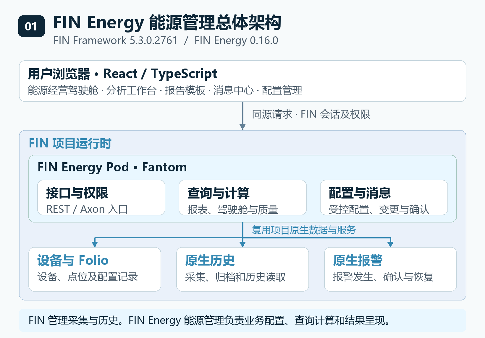
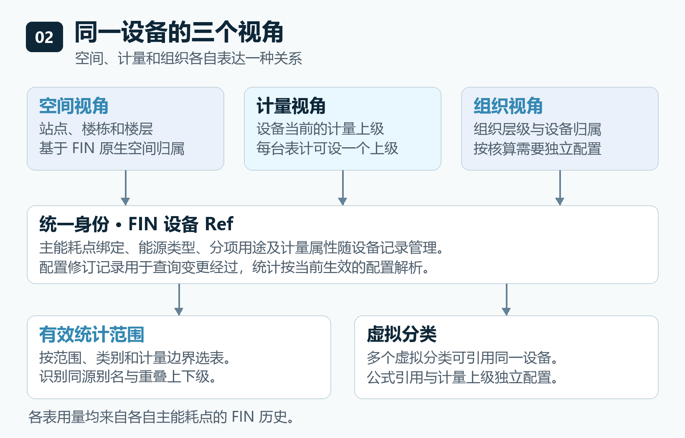
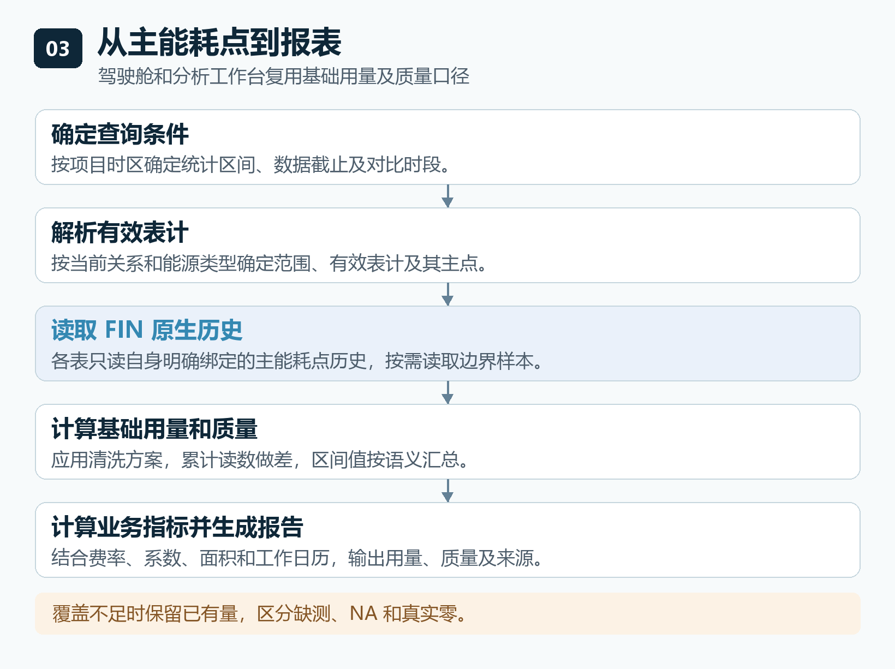
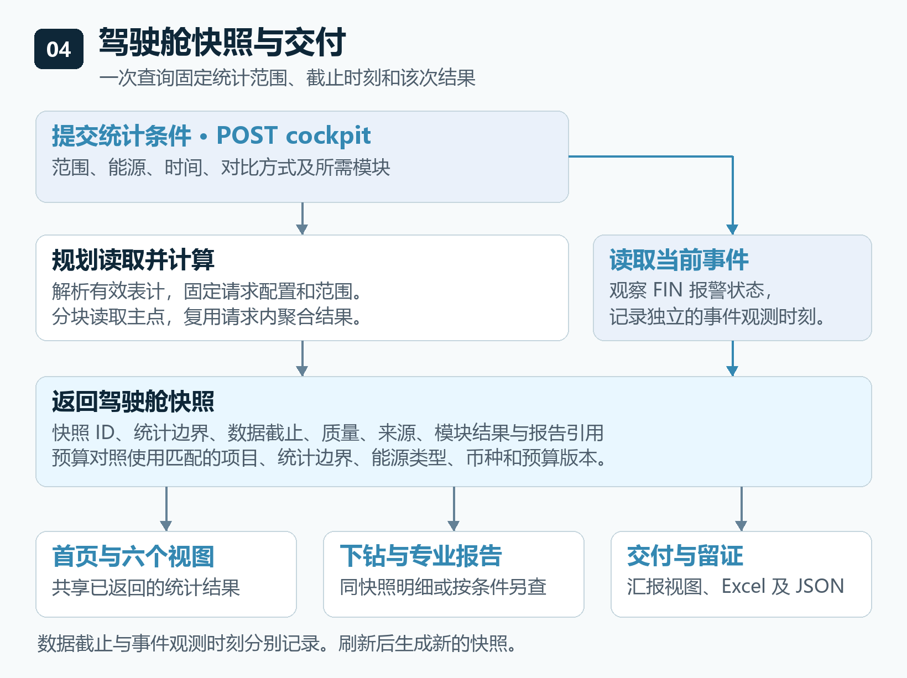
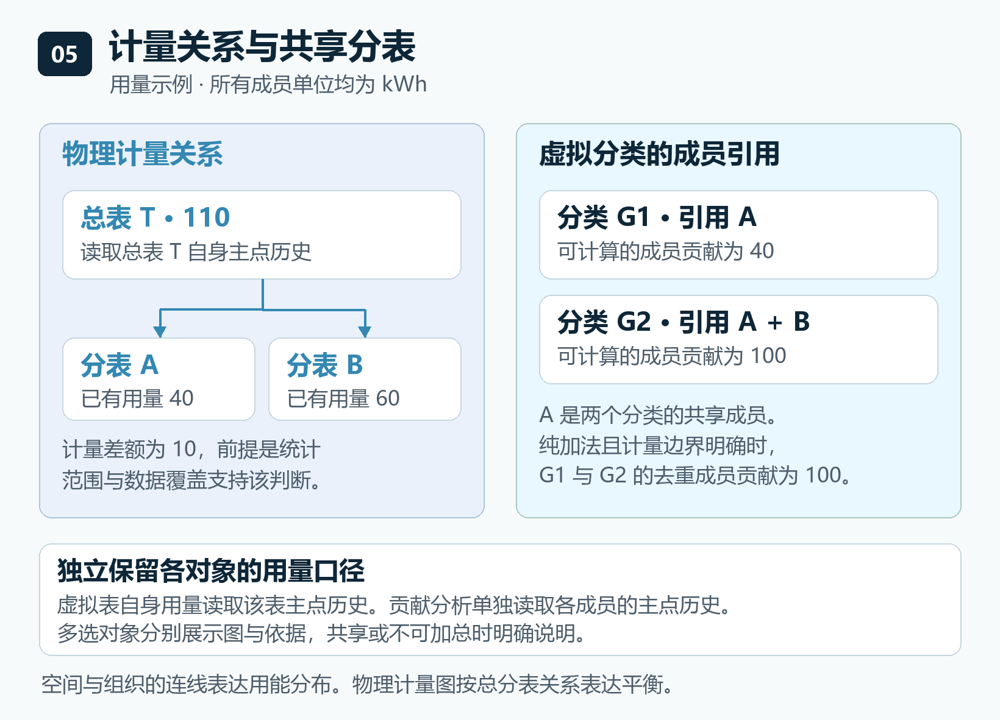
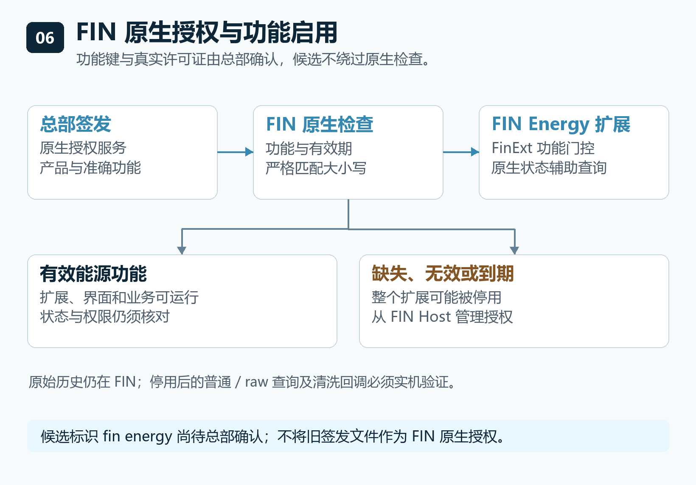
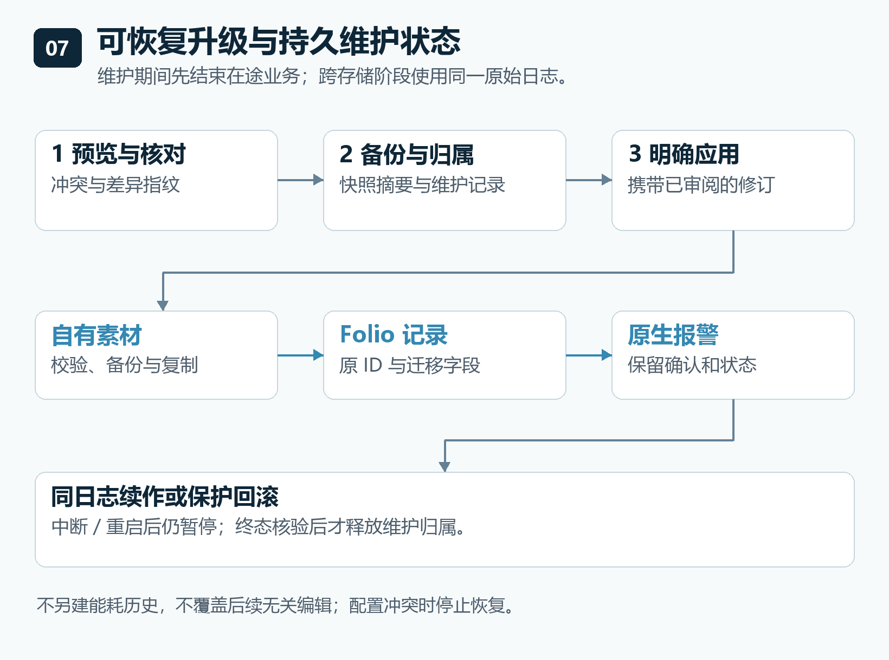

# FIN Energy 能源管理软件架构与详细设计

**FIN Energy · FEN-SDD-001 · 文档版本 3.0 · 2026-11-20**

[English version](finenergy-architecture-design.en.md)

适用版本为 FIN Energy **0.16.0 候选版**、FIN Framework **5.3.0.2761**。本文供开发、工程实施和验收人员使用，说明设备用量如何从 FIN 历史进入报表、驾驶舱和导出，以及配置、当前值计算与报警的写入边界。详细 HTTP 和 Axon 契约见 [中文版接口文档](../contracts/api.zh-CN.md)。

| 基线 | 依据 |
| --- | --- |
| 代码与接口 | developer / 0.16.0 候选；实际源码和包以交付清单为准。 |
| 当前准备 | 本次未替换正在运行的 FIN；历史安装结果按原版本单列。 |
| 产品边界 | 面向楼宇及园区的能源分析。费用按已配置费率计算，用于运营比较与预算跟踪。 |
| 文档沿革 | 本候选版更新此前0.14.37设计。历史运行证据见 [0.14.37 交付记录](../specs/cockpit-parity-20261101/final-handoff-01437.md) 为准。 |

## 1 系统总体架构

FIN Energy 能源管理以单个 `finEnergy.pod` 运行在 FIN 进程内。FIN 提供项目、用户身份、设备记录、点位历史、连接器和报警服务。FIN Energy 能源管理在同一项目中管理能源业务配置，按查询范围读取原生历史，生成分析结果和导出。应用用量的事实来源是设备明确绑定的**主能耗点历史**。

| 层 | 主要入口和职责 |
| --- | --- |
| 前端 | `finEnergy.pod/ts/src`。React 与 TypeScript 实现概览、分析工作台、模板、消息中心和设置。页面保存草稿条件，查询成功后用返回结果渲染。 |
| FIN 扩展和协议 | `FinEnergyExt` 挂载项目入口并跳转至版本化静态资源。`FinEnergyRest` 分派 HTTP 路由，`FinEnergyLib` 提供 Axon 入口。 |
| 项目访问 | `FinEnergyRepo` 负责项目内目录、设备和配置操作。原生设备、空间、清洗、报警适配器在 FIN 上下文中执行读写和授权。 |
| 查询与计算 | `FinEnergyHistory` 读取和适配原生历史，`fan/engine` 计算时间桶、汇总、费用、差额和预测。`FinEnergyCockpit` 编排同一驾驶舱请求内的报表和视图。 |
| 部署资源 | `build.fan` 定义 Pod 版本及依赖。前端产物、`lib`、`locale` 和静态资源随 Pod 交付。 |

FIN 入口走项目同源请求。登录会话决定默认语言，界面允许按当前用户保存中文、English 或跟随 FIN 的偏好。页面文案集中在 `i18n.ts` 与词库，FIN 原生入口通过本地化资源显示。项目、设备和用户输入的名称沿用原文。

## 2 设备身份与业务关系

同一原生设备 Ref 在各视角保持一致。空间沿用 FIN 的站点、楼层和设备归属，计量关系使用设备上的单个上级引用，组织归属独立维护。分类虚拟表的公式引用用于表达计算来源，成员可以被多个虚拟分类引用。查询在权限范围内使用**当前配置**，关系变更作为消息中心记录。选择的历史日期仍决定读取的原生历史区间。

| 对象 | 存储与生命周期 |
| --- | --- |
| 原生设备和点位 | 复用 FIN Ref、设备名、原生空间归属和历史。设备上的 `finEnergy*` 标签记录主点、计量上级、用途、能源类别和组织等应用属性。 |
| 业务配置 | 组织、能源类别、费率、系数、清洗方案、模板等保存在项目 Folio。驾驶舱的预算、核查规则和素材也按项目维护。 |
| 报表和驾驶舱 | 查询结果包含有效边界、口径和质量信息。浏览器可以保存本次成功结果用于展示和导出，原生历史仍由 FIN 保存。 |
| 既有历史与旧配置 | 保留旧引用和历史的兼容与保护。设备取消纳入、配置更改和迁移使用各自的显式入口，普通查询只读。 |

选择空间、组织或计量范围时，先解析可访问的设备及实际统计边界。只有有效设备集合、去重口径、时间区间、数据截止、能源类别、清洗和单位等条件相同，跨视角的基础用量才可直接核对。父子边界重叠、共享计量源、单位不兼容等情况由对应报告标明可加性。面积强度同时保留面积来源和分母，重叠服务面积按范围校验。

## 3 主点历史与分析查询

普通报表经 `FinEnergyRepo.report` 准备参数、目录和权限，再由 `FinEnergyHistory` 取数并调用计算引擎。历史适配在 FIN 上下文读取绑定主点并检查访问权限，计算引擎消费整理后的输入。对比和能流结果引用到的来源也会做可见性检查。

1. **定范围。** 按项目时区解释起止时间。区间采用左闭右开 `[from, to)`。数据截止用于限定本次可观察范围，参考期单独声明起止与可比性。
2. **取历史。** 实测表、物理总表和虚拟表均读取各自显式绑定的主点。总表缺主点或主点无历史时保留缺测。公式成员和直属分表可单独贡献证据，用量仍来自各自的主点。
3. **解释读数。** 累计读数先按相邻读数计算增量，区间量按覆盖规则归并。瞬时量、功率及参考曲线依照各自类型解释。必要边界、复位、回绕和过滤影响结果质量，原生趋势可查看读数。
4. **清洗和汇总。** 查询采用配置的清洗规则，记录过滤、替代和覆盖。时间桶和设备边界确定后计算用量，再按费率、折算或碳因子计算派生指标。跨源与跨单位汇总须有兼容的统计语义。
5. **展示与导出。** 图、明细和导出复用成功的结果。已知小计、完整区间值、缺测、NA、真实零和替代值分别表达。最新观察到的样本时间用于说明来源，区间完整性另由覆盖判定。

原有派生分钟档案及按历史关系生效期分段属于早期架构。现行报表使用主点历史和当前配置。`FinEnergyMeterGeneration` 保留兼容入口，`update` 和 `ensure` 停用，发布及重算入口拒绝调用。部分缺测时，已读到的值仍可展示，完整用量、差额或比较值按各自质量门槛决定是否成立。

## 4 驾驶舱和快照

`POST /cockpit` 将统计范围、能源、时间、比较和所需模块交给驾驶舱编排层。焦点切换使用当前快照。显式应用查询条件、同条件重查和已启用的自动刷新均可生成新快照，自动刷新使用已应用的条件。时间支持今日、本月、本年和自定义。比较的实际起止、项目时区及月末或夏令时调整随响应返回。

| 环节 | 设计 |
| --- | --- |
| 边界和截止 | 解析有效设备和主点，冻结本次实际区间、配置指纹和数据截止。相同截止的重新查询仍可能看到迟到数据或配置更新。 |
| 有界准备 | 按主点分块读取，在请求内准备时间桶、覆盖、清洗和诊断摘要。多个视图和关联报表复用这些结果。读取、并发、耗时与响应大小超过保护边界时返回显式错误。 |
| 模块组装 | 指标、空间、趋势、时间、用途、组织、计量平衡、能效、重点核查组成同一快照。各模块提供状态、原因和关联报表。可隔离模块失败允许其他成功结果保留。 |
| 交互和导出 | 六个视角切换可消费已有结果。领导简报、Excel、JSON 和打印投影使用前端冻结的本次结果。小时证据可以用独立范围查询，返回时可恢复原快照。 |

预算按匹配的统计边界、能源、月份与币种选择，并按配置的分布计算截止时点的期间预算。费用完整且可比较时计算正式偏差。已有费用不足以代表完整覆盖时，仅在相应条件满足时提供标注的参考偏差和参考预算使用率。日历进度可独立展示。预算压力线索使用满足正式比较条件的结果，非工作时段线索依据已配置日历、阈值和有效覆盖。

驾驶舱重点核查读取当前事件观察和质量证据。当前事件状态与历史统计截止分别表达。确认与恢复是独立状态，确认后未恢复的事件仍属持续中。消息中心按稳定事件标识定位已有事件。

## 5 业务模块详细设计

| 模块 | 主要设计与结果边界 |
| --- | --- |
| 趋势与负荷 | 区分原生趋势、周期用量、日内负荷和参考曲线。聚合与图表使用项目时区。完整本地日和不完整日分别处理。 |
| 构成与排名 | 同一选定边界内生成分项、占比和排名。普通分项报告按自身规则解析适用表计。驾驶舱分项沿用驾驶舱有效边界。 |
| 对比分析 | 用同样的统计条件计算基准期和目标期。支持适用的时间对齐和对象比较，变化率要求参考值有效且分母非零。 |
| 效率与折算 | 以能耗、面积、费率和适用系数计算指标。COP 基于同一有效覆盖边界的总输出除以总输入，缺配置或分母为零时提供原因。 |
| 泄漏与差额 | 左侧总表用量和右侧分表已有堆叠分别显示。分表参与但缺测时保留其他分表已有量。两侧都有值时显示已有用量差值，总表非零时可给出相应比率。完整区间差额与泄漏判断另行校验数据覆盖、边界和来源。 |
| 能耗预测 | 历史训练、检验与预测时间分离，已实现模型按可用数据选择。历史和有效样本不足时返回状态与原因。预测值及其费用估算与实际历史分开。 |

普通报表以 `ReportRequest` 传入报表类型、维度、对象、时间、粒度和指标。查看某块表一周的每日用量时，请求可使用 `kind=profile`、`dimension=metering`、`period=day`、`metric=energy`，并以目录返回的 Ref 指定对象。返回的 `series` 用于时序绘图，`rows` 用于统计明细，`summary` 汇总统计对象，`extra` 携带各报表的补充依据。相同的成功结果可用于报表导出和复核。

原始趋势用于核对 FIN 中记录的时间戳和读数，周期用量用于核对所选区间的用量。排查某天的报表缺口时，先核对指定主点、统计区间边界与清洗状态，再用覆盖和来源解释该日是否形成有效用量。参考曲线是上下文观测，保留来源和采样依据，业务合计与计量差额使用纳入统计的用量。

### 5.1 能流图与共享表计

能流图使用空间、组织或计量视角和显式范围。空间与组织展示所选层级的能源分布，计量视角展示物理总分关系，虚拟分类展示公式引用来源。多选对象可以返回多个独立图，保留各图依据、参与成员、共享来源和合计资格。

例中物理总表 T 为 110 kWh，直属分表 A、B 为 40、60 kWh。分类 G1 引用 A，G2 引用 A+B。若两分类各自主点历史分别为 40、100 kWh，页面按各自历史显示。两分类共享 A，且满足纯加法、授权、单位和边界条件时，贡献范围按 A、B 去重得到 100 kWh。物理总表仍显示自身的 110 kWh。物理差额的可用性由覆盖、计量关系与来源独立性判断。

公式 `2*A`、`A-B`、同源别名、嵌套引用和祖先重叠分别处理。非纯加法和不可证明的边界保留对象值并标明合计限制。可安全展开的纯加法分类可给出去重贡献值，即使分类值之间存在共享而不可直接相加。费用范围合计按有效费用表计边界计算，图内贡献引用独立解释。

## 6 接口和权限

HTTP 基址为 `/api/{project}/ext/finEnergy/v1`。调用使用 FIN 原生会话和同源请求。所有 POST 请求均走 FIN 防跨站请求机制，配置写入还要求管理员权限。业务 JSON 用 `ok/data` 或 `ok/error` 信封，图片和入口跳转按各自响应类型返回。参数、错误码、字段、完整路由和兼容行为以 [中文版接口文档](../contracts/api.zh-CN.md) 为准。

| 用途 | 主要 HTTP 入口 | 访问属性 |
| --- | --- | --- |
| 会话和目录 | `GET session`、`catalog`、`tree`、`points` | 登录用户按项目权限读取。 |
| 分析 | `POST report`、`cockpit`、`cleaning/preview` | 查询或预览。适用的对象、点位和配置依据在项目内读取。 |
| 计量和配置 | `POST records`、`records/delete`、`tree/manage` 等 | 写权限、输入校验和适用的版本冲突检查。 |
| 驾驶舱配置 | `cockpit/budgets`、`cockpit/rule-profiles`、`cockpit/assets` 和配置审计 | 列表与内容读取受项目权限控制，保存、删除、上传和选用走对应写入口。 |
| 消息和任务 | `GET alarms`、`messages/changes`，`POST alarms/ack`、`tasks` | 读取、确认和扫描分别授权。 |

Axon 入口复用同项目的仓储及计算路径。`finEnergyReport` 用于报表，`finEnergyCatalog` 用于目录，`finEnergyInfo` 用于版本核对。`finEnergySaveConfig`、`finEnergyManage` 等配置操作走写权限。工程验收函数依其专用约束执行，接口文档另列相应边界。

权限校验位于后端。界面禁用按钮只是用户提示。配置更新使用适用的 Ref 和修订版本识别并发修改，服务端校验关系、类型和目标。迁移支持预览和显式应用，迁移工具与常规查询分开。

## 7 当前值 报警与运行保护

**当前值计算。** `FinEnergyExt` 的周期检查按项目配置触发 `FinEnergyMeterRollup`。设备配置为按分表计算或绑定表达式，且目标主点符合归属和采集保护条件时，更新允许的瞬态当前值、状态及必要的连续性元数据。带采集连接器的实测点受保护。历史采集由 FIN 执行，报表随后仍以 FIN 保存的主点历史为依据。

**报警与消息。** `FinEnergyJobs` 负责有界报警扫描和启停配置，周期任务使用 FIN 原生调度，扫描采用共享任务锁。报警从用量和已配置阈值生成或更新原生事件，并保留确认、恢复等状态。计量关系和相关设置的重要变更以日志进入消息中心。查询驾驶舱只读取相关事件。

**资源保护。** 驾驶舱限制包括单请求设备、能源类别、COP 配置、时间跨度、样本块、累计扫描量、并发、执行时间及响应体积。同项目最多两个并发请求，同用户在该项目最多一个。20 秒为软目标，请求使用 30 秒服务端检查期限，序列化响应体积上限为 8 MiB。达到限制时返回原因供界面处理。普通分析工作台保留各自的样本保护。部署和性能验证记录范围、区间、样本量和环境。

**构建与部署。** 根清单、前端包及锁文件、`build.fan` 版本由 `node scripts/check-versions.mjs` 核对。构建产物随 Pod 打包，版本化入口和前后端版本检测用于识别旧页面缓存。本机发布按团队约定核对旧包备份、候选包哈希、运行版本和关键接口。安装包与查询证据见交付记录。

## 8 历史验证与追溯

| 验证层 | 0.14.37 的已记录结果 |
| --- | --- |
| 源码与构建 | 后端 122 类、1005 方法、300033 项校验，前端类型检查、Vite 与 Pod 构建通过。437 项前端测试在 GitHub 推送前降低并行度复跑通过。 |
| 本机 FIN | `cubeTest`、`zeda` 当前月查询成功。固定九类范围首轮成功。已有预算的参考偏差用独立计算核对，费用部分覆盖时正式偏差为空。 |
| 导出与界面 | 六份中英文 Excel 回读重建同一快照。中英文、桌面及移动布局有真实响应回放证据。 |
| 验收限制 | zeda 年度首轮查询 28.484 秒，20 秒软目标未达。最新原生页面、正常鉴权只读账号及原生打印保留在验收清单。采集健康由 FIN 项目另行核对。 |

| 设计主题 | 源码与证据 |
| --- | --- |
| 路由、会话与 Pod 资源 | [FinEnergyExt](../finEnergy.pod/fan/FinEnergyExt.fan)、[FinEnergyRest](../finEnergy.pod/fan/FinEnergyRest.fan)、[FinEnergyLib](../finEnergy.pod/fan/FinEnergyLib.fan)、[build.fan](../finEnergy.pod/build.fan) |
| 主点、清洗、当前值 | [FinEnergyHistory](../finEnergy.pod/fan/FinEnergyHistory.fan)、[FinEnergyMeterRollup](../finEnergy.pod/fan/FinEnergyMeterRollup.fan)、[FinEnergyMeterGeneration](../finEnergy.pod/fan/FinEnergyMeterGeneration.fan) |
| 普通报表与多视角 | [FinEnergyRepo](../finEnergy.pod/fan/FinEnergyRepo.fan)、[FinEnergyEngine](../finEnergy.pod/fan/engine/FinEnergyEngine.fan)、[FinEnergyEnergyFlow](../finEnergy.pod/fan/engine/FinEnergyEnergyFlow.fan) |
| 驾驶舱与预算 | [FinEnergyCockpit](../finEnergy.pod/fan/FinEnergyCockpit.fan)、[FinEnergyCockpitRegistry](../finEnergy.pod/fan/FinEnergyCockpitRegistry.fan)、[FinEnergyCockpitBudget](../finEnergy.pod/fan/FinEnergyCockpitBudget.fan)、[cockpitExports](../finEnergy.pod/ts/src/cockpitExports.ts) |
| 接口和交付 | [中文版接口契约](../contracts/api.zh-CN.md)、[功能账本](feature-parity.md)、[0.14.37 交付记录](../specs/cockpit-parity-20261101/final-handoff-01437.md) |

## 9 FIN 原生授权

`FinEnergyExt` 继承 `fin::FinExt` 并声明 `@FinExtMeta.licFeature`。候选标识为严格匹配的 `fin energy`，须由总部确认。激活、有效期和功能校验由 FIN 原生授权负责；应用在权限允许时提供只读状态和机器码，不导入旧 RSA 文件，不实施每项目 10 块表的回退规则，不签发 FIN 许可证。

原生检查先于应用业务执行。缺少功能时，整个扩展及其入口可能被停用，包括 Axon 库和清洗回调的可用性。原始历史仍由 FIN 保留，但这不等于已证明所有清洗后的 `hisRead` 在停用后仍能工作。真实授权验收须用总部许可证覆盖有效、缺失、到期、重启及多项目场景。准确功能键和比利时客户完整平台仍待外部确认。

## 10 可恢复的命名空间升级

既有项目通过明确操作迁移 `enerCubix*` 产品标签到 `finEnergy*`。FIN 标准标签、用户名称和原记录 ID 保留。迁移包含精确的产品清洗回调、调度表达式、结构化配置、原生设备迁移 Zinc 快照、单例标记定位以及私有驾驶舱图片。

管理员先预览完整迁移后关系图。目标标签、单例、连续性状态所有者或重复能源任务冲突时停止。应用须携带当前差异指纹；正常采集值变化不会使未变的业务配置持续失效。发布前保存全部受影响记录的完整 Folio／报警迁移前后快照、素材哈希及独立备份摘要，分阶段进度文件采用原子替换。同一日志续作仅接受合法的迁移前／后状态。回滚只逆转迁移字段，保留后续原生当前值、确认状态及无关字段；相关业务字段冲突时停止恢复。

这是跨存储维护，不是单一分布式事务。必须持续暂停能源任务和配置写入，直到原日志达到 `complete` 或 `rolledBack`。持久化项目维护记录在首次跨存储发布前取得，绑定项目、原日志和快照摘要；Folio 已改而报警未改及重启后仍持续阻止应用查询、配置、扫描与合计。只有核对原始日志及快照且阶段为 complete／rolledBack 才清理。维护隔离按项目生效；未处于维护状态的其他项目继续执行后台合计。已在途操作仍需在维护前结束。每个受影响项目分别迁移和核对，具体操作见升级说明。

## 11 J2 品牌与语言资源

界面采用 J2 Deep Blue #0e2738、Blue #3488b2、Aqua #00ccff，以及品牌绿和紫色。Manrope 字体随包提供，中文回退微软雅黑或合适的系统字体。临时产品图标可统一替换，不冒充总部最终标识。文档使用总部模板中的原始 J2／FIN 素材和 FIN Wave，并保存来源哈希。

中文显示 FIN Energy 能源管理，英文显示 FIN Energy。原生菜单使用 `toLocale` 和 Pod 语言资源；应用跟随当前 FIN 用户语言，保留手动切换，只迁移符合条件的旧用户偏好。项目、设备及用户输入名称不因升级自动翻译。

## 12 候选验证与发布边界

0.16.0 集成源码为候选。构建、SDK 测试、受控浏览器回放和包结构检查，与实际 FIN 运行分别记录。33 个计算引擎文件在命名替换后与上一代码基线相同；这是静态比较，不能替代升级前后的同范围查询核对。

客户交付仍需总部确认功能键、提供真实许可证，以及客户完整 FIN 构建号和操作系统。在相同范围、时间、截止、主点与清洗条件下核对用量、分项、费用及差额；检查原 ID、关系、历史、报警确认和任务唯一性。功能缺失／到期、普通和 raw 历史、原生菜单、重启及恢复仍须实机验收。交付清单记录候选包哈希与实际验证层级。
