# FIN Energy Cockpit Requirements and Prototypes

FIN Energy 0.16.0 candidate · 2026-11-20

This edition retains P01–P55, original requirement IDs and acceptance IDs, and updates branding, native licensing, preferences and migration for the 0.16.0 candidate. Every requirement has a redrawn J2 interaction prototype. A prototype is not a deployed screen or runtime proof; the 55 requirements are not all newly implemented.

## P01 Open the cockpit

SC-01 / AC 01,06

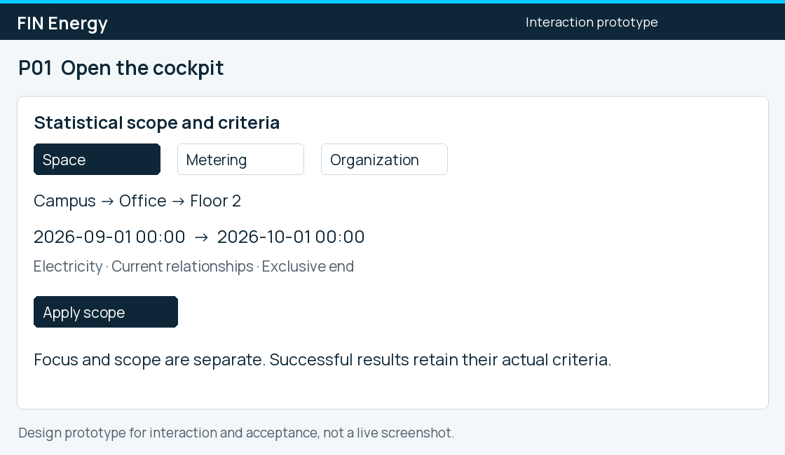

Overview submits the readable scope and this month through FIN query time. The new prototype illustrates the interaction.

**Evidence boundary** Prior 0.14.37 reference: C VA01; F1. Its original version and scenario apply. Candidate source and controlled tests are recorded separately; historical references are not 0.16 runtime passes.

## P02 Investigate from finding to evidence

SC-02 / AC 03,05,09

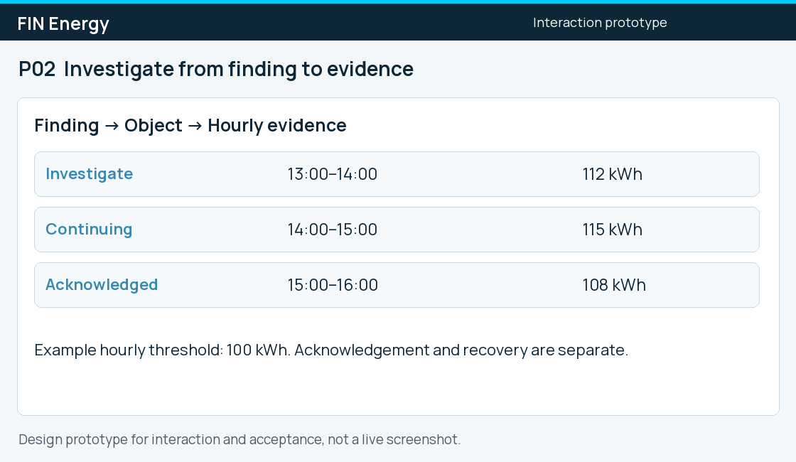

Start from a space focus or priority item. The event carries its identity, related object and separate hourly evidence range.

**Evidence boundary** Prior 0.14.37 reference: I. Its original version and scenario apply. Candidate source and controlled tests are recorded separately; historical references are not 0.16 runtime passes.

## P03 Leadership brief from one snapshot

SC-03 / AC 14

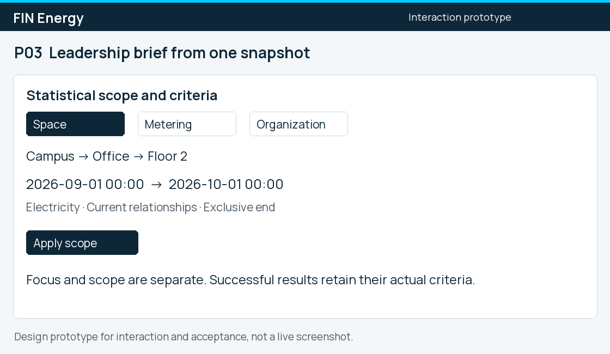

The brief reuses the applied snapshot. It includes the business reference, conclusions and quality. Missing budgets fall back where comparison is eligible.

**Evidence boundary** Prior 0.14.37 reference: C VA12/13. Its original version and scenario apply. Candidate source and controlled tests are recorded separately; historical references are not 0.16 runtime passes.

## P04 Project scope and time

FR-01 / AC 01,04

Select within the current FIN project. Today, month, year and custom are supported. Apply sets the scope, with timezone and exclusive end shown.

**Evidence boundary** Prior 0.14.37 reference: C VA33/36; F2. Its original version and scenario apply. Candidate source and controlled tests are recorded separately; historical references are not 0.16 runtime passes.

## P05 Focus energy selection

FR-02 / AC 02,07

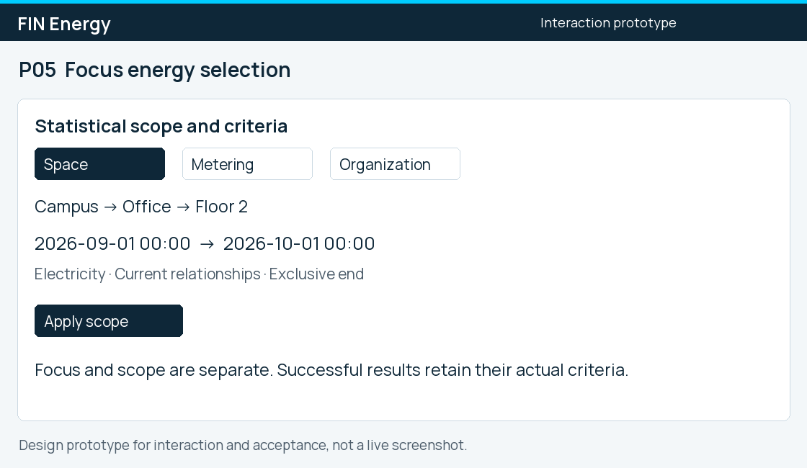

One focus category drives the applicable metrics and faces. An optional auxiliary category or area intensity keeps its own unit.

**Evidence boundary** Prior 0.14.37 reference: I. Its original version and scenario apply. Candidate source and controlled tests are recorded separately; historical references are not 0.16 runtime passes.

## P06 Four cards and graceful degradation

FR-03 / AC 07,08

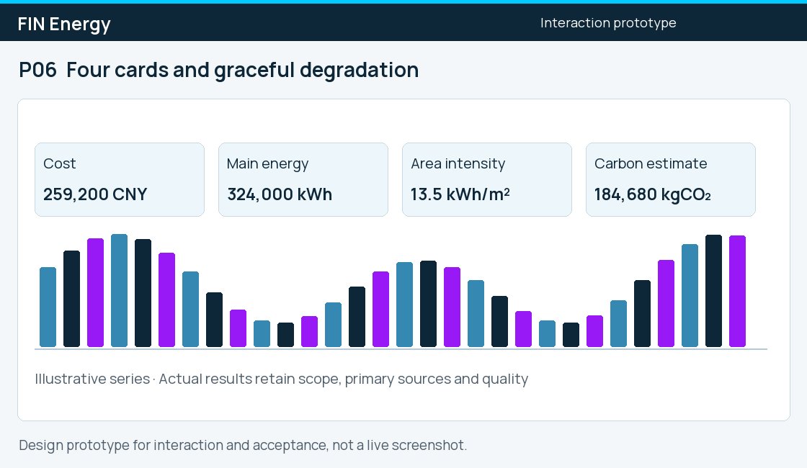

Order is cost, main energy, auxiliary energy or area intensity, and carbon or unrecovered events. An unavailable metric shows its reason.

**Evidence boundary** Prior 0.14.37 reference: C VA02; F1. Its original version and scenario apply. Candidate source and controlled tests are recorded separately; historical references are not 0.16 runtime passes.

## P07 Management conclusion and basis

FR-04 / AC 11,14

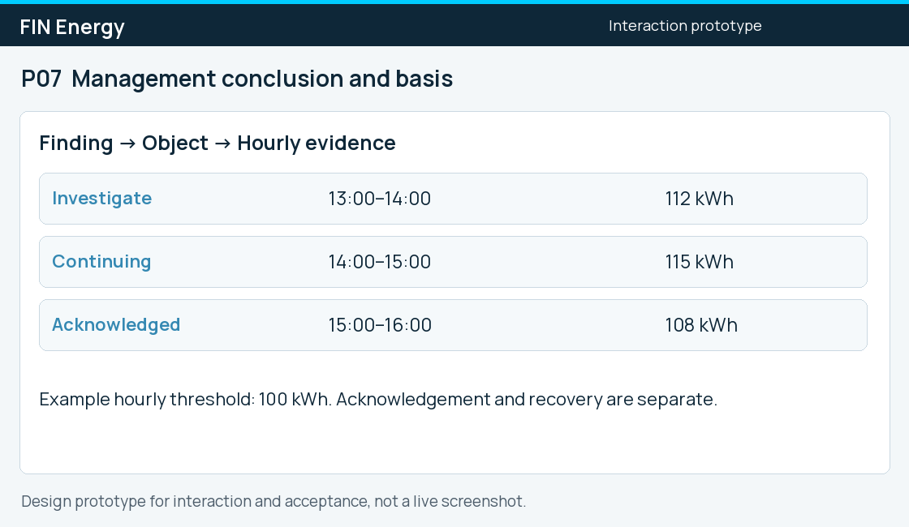

Short conclusions follow eligibility, data quality and active-event rules. Expand to inspect the rule, values and effective period.

**Evidence boundary** Prior 0.14.37 reference: C VA03; F1. Its original version and scenario apply. Candidate source and controlled tests are recorded separately; historical references are not 0.16 runtime passes.

## P08 Overview hierarchy

FR-05 / AC 01,02

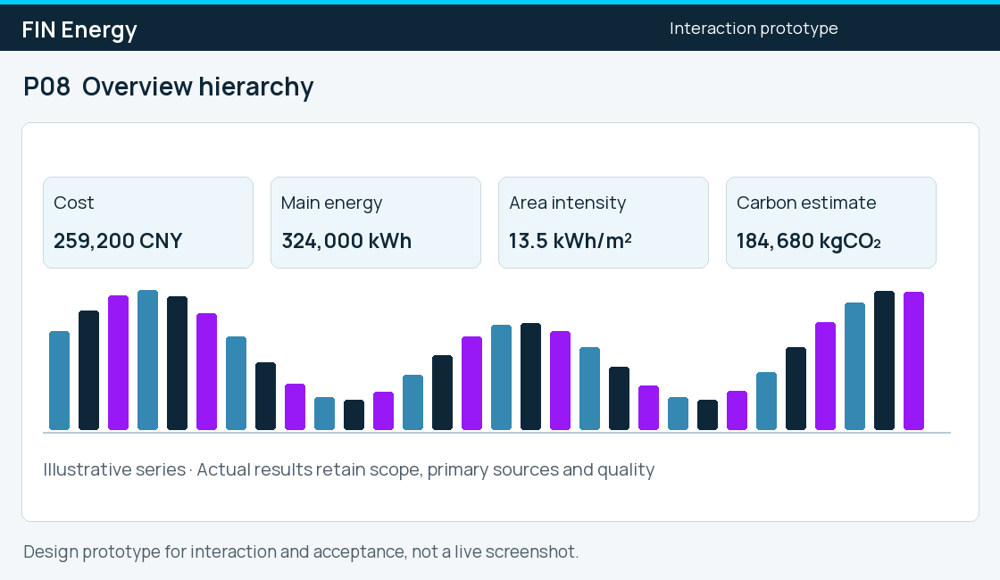

The brief and fixed cards lead to a business reference, observation face and priority checks. Trend and flow provide supporting evidence.

**Evidence boundary** Prior 0.14.37 reference: C VA01/04/06; F1. Its original version and scenario apply. Candidate source and controlled tests are recorded separately; historical references are not 0.16 runtime passes.

## P09 Scope versus focus

FR-06 / AC 03,04,12

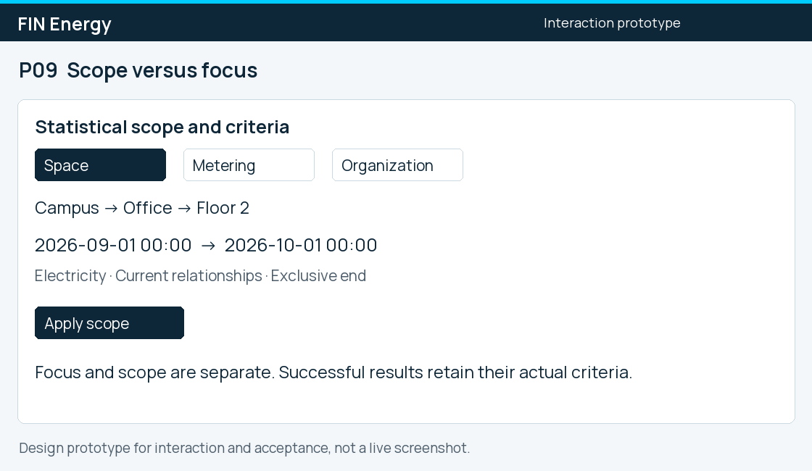

Selecting a focus is local. Applying it as the statistical scope submits a query. Pending and failed requests keep the displayed snapshot's own scope.

**Evidence boundary** Prior 0.14.37 reference: C VA08/10/36. Its original version and scenario apply. Candidate source and controlled tests are recorded separately; historical references are not 0.16 runtime passes.

## P10 Space schematic and list

FR-07 / AC 02,26

The real site/floor hierarchy drives the list and isometric view. Both point to the same space. A readable list covers cases without suitable hierarchy.

**Evidence boundary** Prior 0.14.37 reference: C VA07; F1. Its original version and scenario apply. Candidate source and controlled tests are recorded separately; historical references are not 0.16 runtime passes.

## P11 Inspect a focused object's meters

FR-08 / AC 03,16

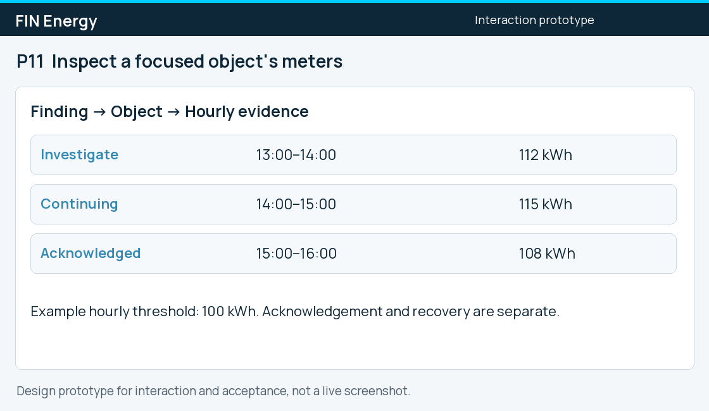

Inspect usage basis, actual equipment relationships and sources for the space focus. Quality or availability explains uncertain relationships.

**Evidence boundary** Prior 0.14.37 reference: C VA09. Its original version and scenario apply. Candidate source and controlled tests are recorded separately; historical references are not 0.16 runtime passes.

## P12 Drill down and return

FR-09 / AC 05,14

Carry absolute bounds, cutoff, category and scope. Recheck user, project, visibility and configuration before restoring the view.

**Evidence boundary** Prior 0.14.37 reference: C VA11/31. Its original version and scenario apply. Candidate source and controlled tests are recorded separately; historical references are not 0.16 runtime passes.

## P13 Hourly evidence for an episode

FR-10 / AC 05,09,21

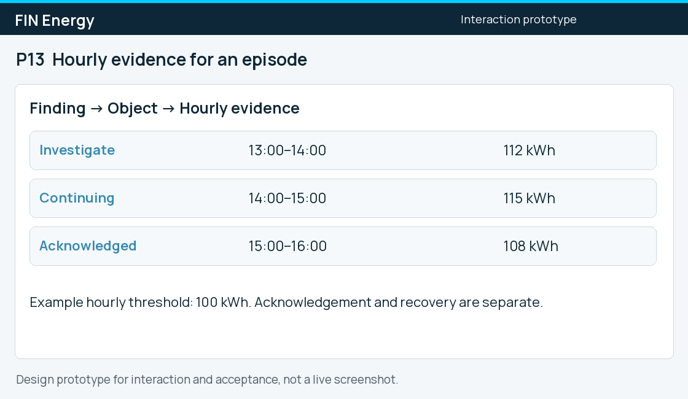

Inspect eligible hourly usage and threshold for the episode. Consecutive hours share one episode. Energy and instantaneous power use distinct units.

**Evidence boundary** Prior 0.14.37 reference: I. Its original version and scenario apply. Candidate source and controlled tests are recorded separately; historical references are not 0.16 runtime passes.

## P14 Alarms, clues and data issues

FR-11 / AC 09,10

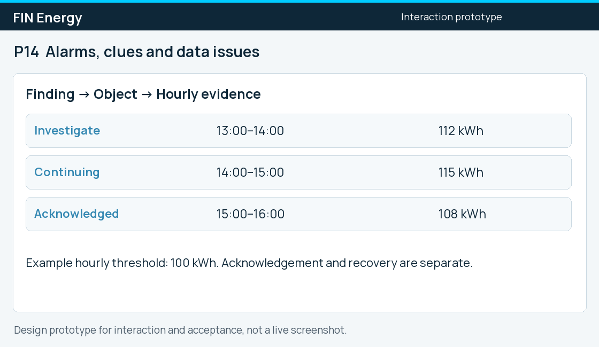

Formal alarms, rule clues and quality issues have separate types. Rule evaluation supplies investigation evidence.

**Evidence boundary** Prior 0.14.37 reference: C M4C03. Its original version and scenario apply. Candidate source and controlled tests are recorded separately; historical references are not 0.16 runtime passes.

## P15 Event details and current state

FR-12 / AC 09,10

Event time differs from state observation time. Acknowledgement and recovery are separate. An earlier unrecovered event can qualify for the current scope.

**Evidence boundary** Prior 0.14.37 reference: I. Its original version and scenario apply. Candidate source and controlled tests are recorded separately; historical references are not 0.16 runtime passes.

## P16 Priority item ordering

FR-13 / AC 09,16

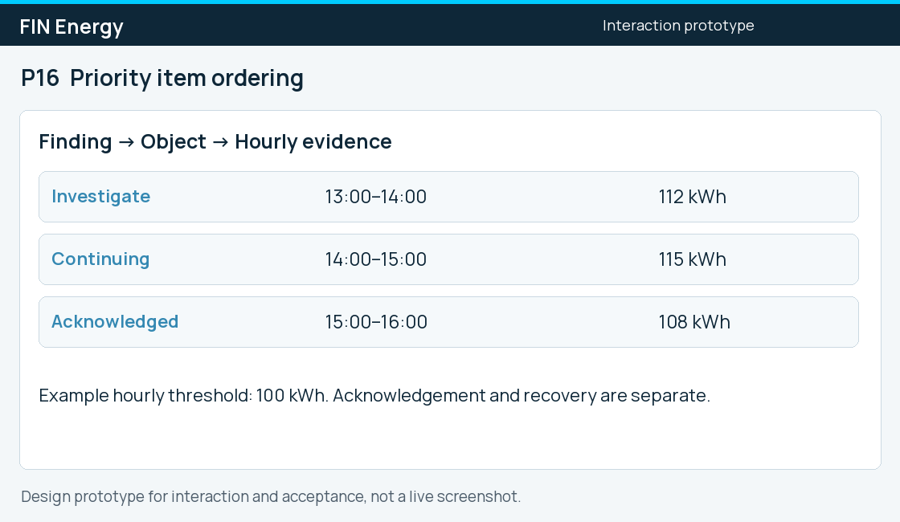

The overview summarizes three items. Expand for the ordered evidence. Blocking quality also appears on the affected metric.

**Evidence boundary** Prior 0.14.37 reference: C VA05. Its original version and scenario apply. Candidate source and controlled tests are recorded separately; historical references are not 0.16 runtime passes.

## P17 Native alarm association

FR-14 / AC 09,10,23

Use the existing episode-to-FIN alarm association. Message center locates the episode. Acknowledgement has a separate operation.

 Migration retains original IDs and updates owned tags, structured snapshots, alarms and asset paths through the original journal.

**Evidence boundary** Prior 0.14.37 reference: I. Its original version and scenario apply. Candidate source and controlled tests are recorded separately; historical references are not 0.16 runtime passes.

## P18 Metering boundary and deduplication

DATA-01 / AC 15

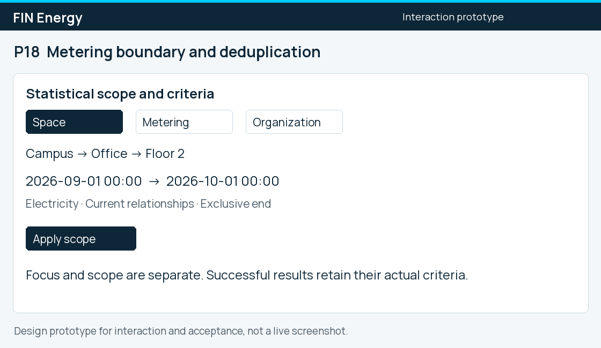

Resolve canonical meters and explicit primary points using current relationships. Overlapping explicit choices retain own values and reasons.

**Evidence boundary** Prior 0.14.37 reference: C VA26/33; Q. Its original version and scenario apply. Candidate source and controlled tests are recorded separately; historical references are not 0.16 runtime passes.

## P19 Difference with missing data

DATA-02 / AC 16,20

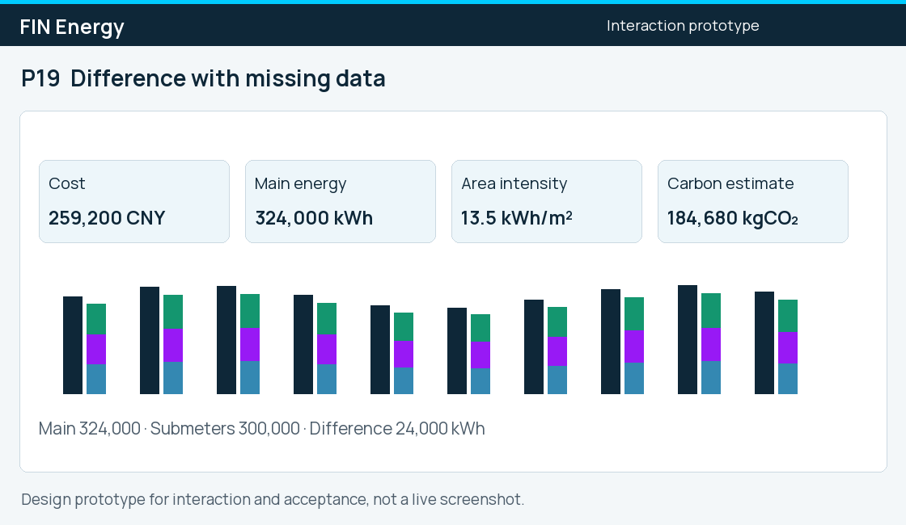

Show known and complete differences separately, with the master as denominator. Keep diagnostics for incomplete coverage and retain a negative sign.

**Evidence boundary** Prior 0.14.37 reference: C VA26/30. Its original version and scenario apply. Candidate source and controlled tests are recorded separately; historical references are not 0.16 runtime passes.

## P20 Precision, real zero and NA

DATA-03 / AC 19,20

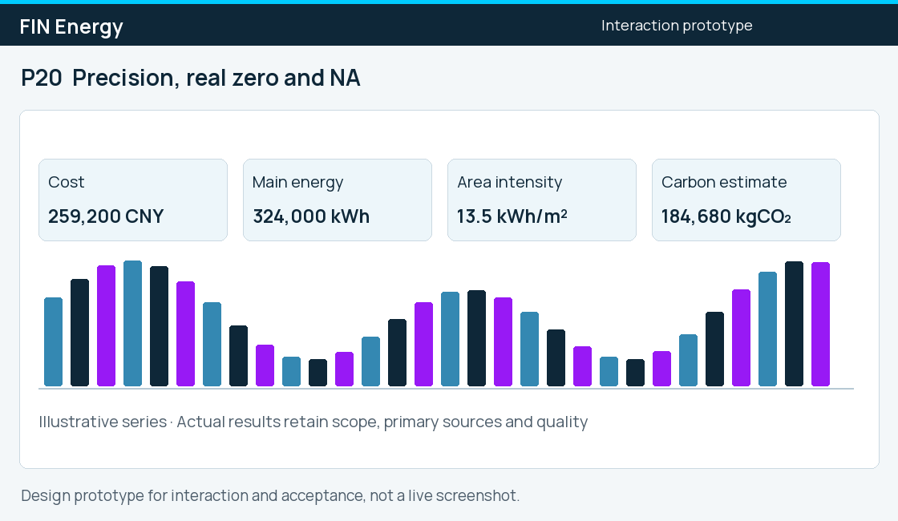

Display rounding leaves stored values intact. Real zero, NA and missing stay distinct. Details or export preserve precision and sources.

**Evidence boundary** Prior 0.14.37 reference: C VA22. Its original version and scenario apply. Candidate source and controlled tests are recorded separately; historical references are not 0.16 runtime passes.

## P21 Closed hours and interval boundaries

DATA-04 / AC 01,22

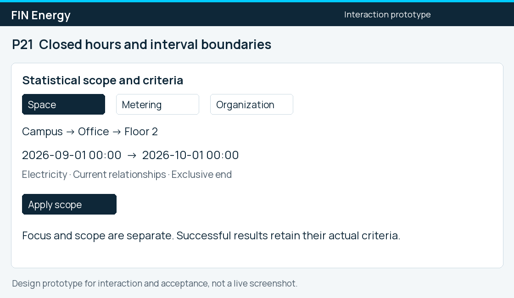

Month-to-date ends at FIN query time. Known usage identifies incomplete tail quality. Heatmaps and hourly rules retain completeness checks.

**Evidence boundary** Prior 0.14.37 reference: C VA23; Q. Its original version and scenario apply. Candidate source and controlled tests are recorded separately; historical references are not 0.16 runtime passes.

## P22 Year and month comparison

DATA-05 / AC 11,22

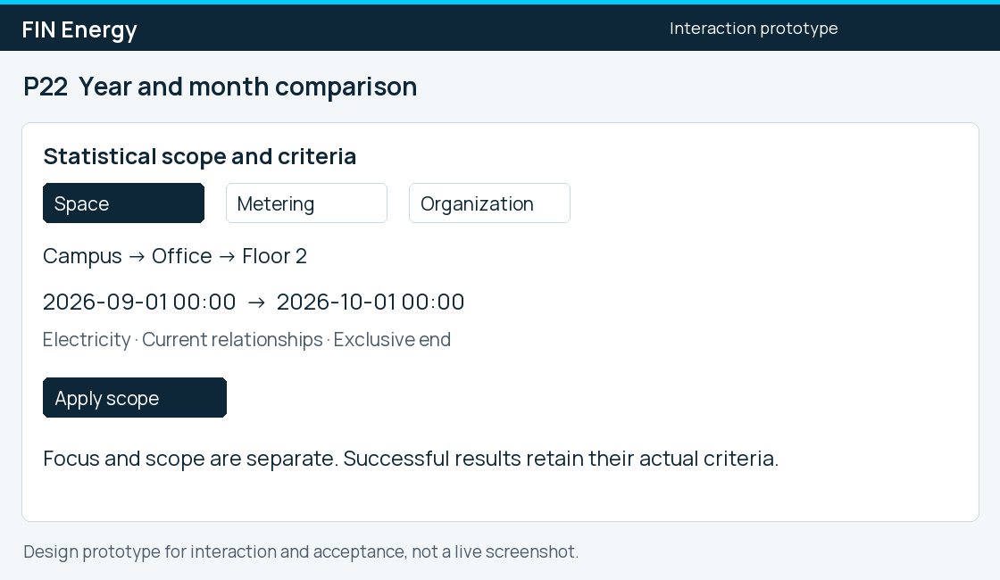

Default is year over year for month/year and prior-day cutoff for today. Month/custom can shift one calendar month, with adjustment details.

**Evidence boundary** Prior 0.14.37 reference: F2; I. Its original version and scenario apply. Candidate source and controlled tests are recorded separately; historical references are not 0.16 runtime passes.

## P23 Unavailable comparison

DATA-06 / AC 11

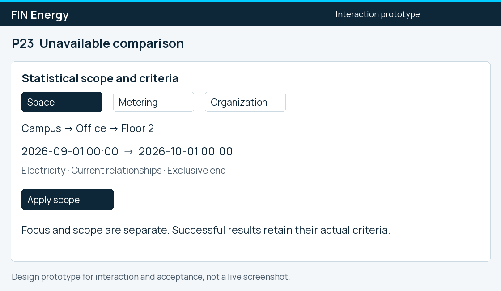

Missing, substituted, incompatible and zero-reference conditions carry reasons. Keep the chosen mode and omit ineligible percentages.

**Evidence boundary** Prior 0.14.37 reference: I. Its original version and scenario apply. Candidate source and controlled tests are recorded separately; historical references are not 0.16 runtime passes.

## P24 Module coverage

FR-15 / AC 16,17,18

The overview shows a short summary and expandable coverage and cleaning. An unavailable input in one module leaves other successful modules visible.

 Whole-extension license failure is not ordinary module degradation; other modules are not guaranteed to query.

**Evidence boundary** Prior 0.14.37 reference: C VA35. Its original version and scenario apply. Candidate source and controlled tests are recorded separately; historical references are not 0.16 runtime passes.

## P25 Source and cleaning trace

FR-16 / AC 17,18,19

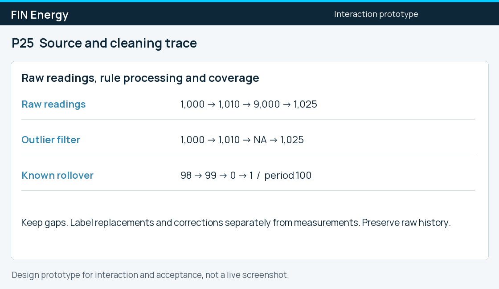

Retain primary points, frozen cleaning settings, filtering, substitution, rollover and coverage. Report totals and limited diagnostics remain distinct.

 Migration retains original IDs and updates owned tags, structured snapshots, alarms and asset paths through the original journal.

**Evidence boundary** Prior 0.14.37 reference: C VA35; I. Its original version and scenario apply. Candidate source and controlled tests are recorded separately; historical references are not 0.16 runtime passes.

## P26 Period budget and validation

FR-17 / AC 29,31,32

Match scope, category, currency and month. Daily amounts reconcile to the total. DST allocation uses the actual local day length.

 Migration retains original IDs and updates owned tags, structured snapshots, alarms and asset paths through the original journal.

**Evidence boundary** Prior 0.14.37 reference: C M4B02/04. Its original version and scenario apply. Candidate source and controlled tests are recorded separately; historical references are not 0.16 runtime passes.

## P27 Budget progress and variance

FR-18 / AC 29,30

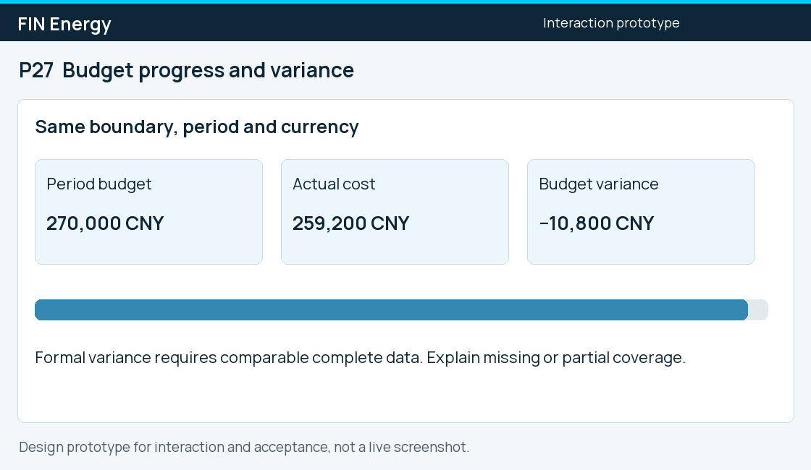

Show period and full-month budgets, calendar progress and cost. Eligible known cost can supply a labeled reference while formal variance stays empty.

 Migration retains original IDs and updates owned tags, structured snapshots, alarms and asset paths through the original journal.

**Evidence boundary** Prior 0.14.37 reference: C M4B01; X. Its original version and scenario apply. Candidate source and controlled tests are recorded separately; historical references are not 0.16 runtime passes.

## P28 Budget fallback and read-only access

FR-19 / AC 06,23,31

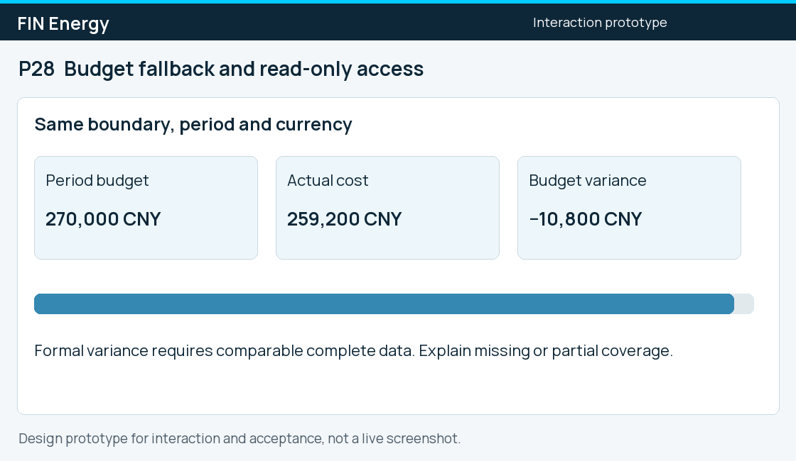

Check exact boundary and currency. Missing budgets fall back to eligible comparison. Writes require permission. Real read-only budget acceptance is deferred.

 Migration retains original IDs and updates owned tags, structured snapshots, alarms and asset paths through the original journal. Deferred native read-only scenarios still require target FIN verification.

**Evidence boundary** Prior 0.14.37 reference: I; D M4B03. Its original version and scenario apply. Candidate source and controlled tests are recorded separately; historical references are not 0.16 runtime passes.

## P29 Budget variance clue

FR-20 / AC 29,31

The rule uses formal period variance, currency, threshold and quality. Known cost reference is displayed separately.

 Migration retains original IDs and updates owned tags, structured snapshots, alarms and asset paths through the original journal.

**Evidence boundary** Prior 0.14.37 reference: C M4C01/03. Its original version and scenario apply. Candidate source and controlled tests are recorded separately; historical references are not 0.16 runtime passes.

## P30 Layouts share the snapshot

FR-21 / AC 14

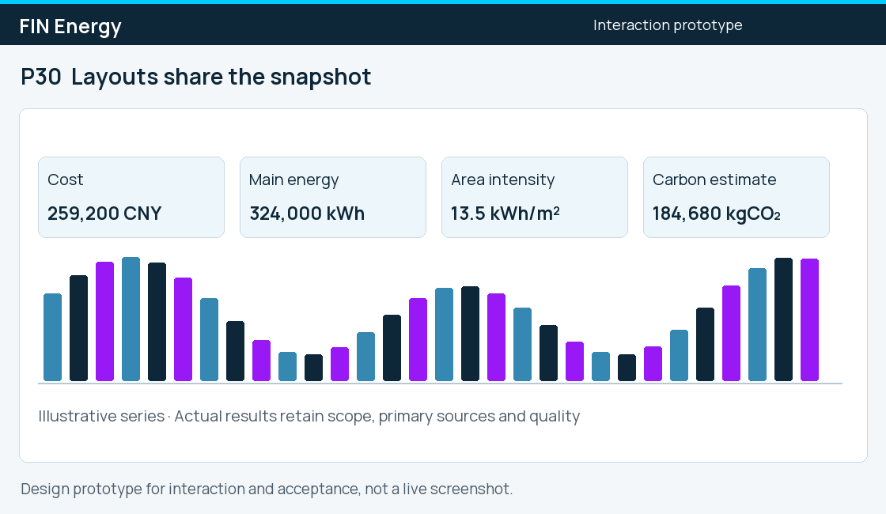

Overview and leadership brief use the same snapshot and metrics. The action changes the reading layout.

**Evidence boundary** Prior 0.14.37 reference: C VA13. Its original version and scenario apply. Candidate source and controlled tests are recorded separately; historical references are not 0.16 runtime passes.

## P31 Enter and exit full screen

FR-22 / AC 14,26

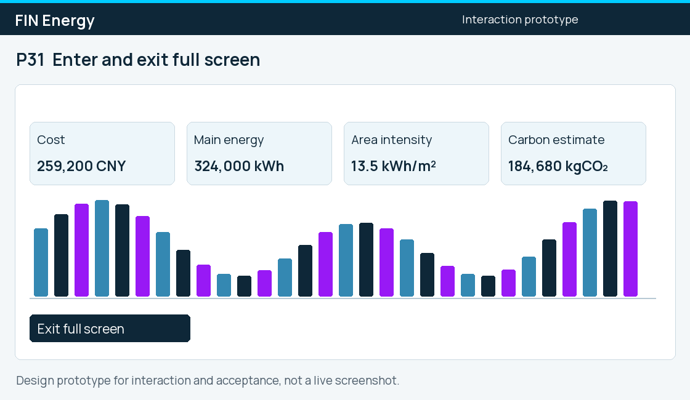

Enter or exit full screen explicitly. Presentation and available-state cues remain, and exit restores the preceding view.

**Evidence boundary** Prior 0.14.37 reference: C VA14. Its original version and scenario apply. Candidate source and controlled tests are recorded separately; historical references are not 0.16 runtime passes.

## P32 Frozen snapshot export

FR-23 / AC 14

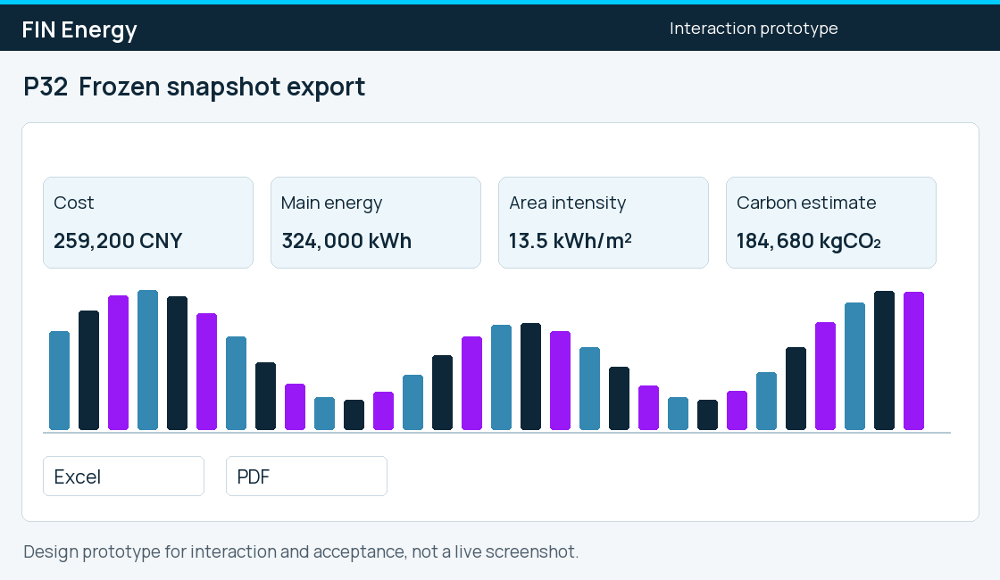

Freeze scope, comparison, quality and language for Excel, JSON and print layout. Native print/PDF acceptance remains deferred.

 Export branding is updated. Controlled PDF export does not establish native print acceptance.

**Evidence boundary** Prior 0.14.37 reference: I; X; D VA15. Its original version and scenario apply. Candidate source and controlled tests are recorded separately; historical references are not 0.16 runtime passes.

## P33 Language settings

NFR-01 / AC 24

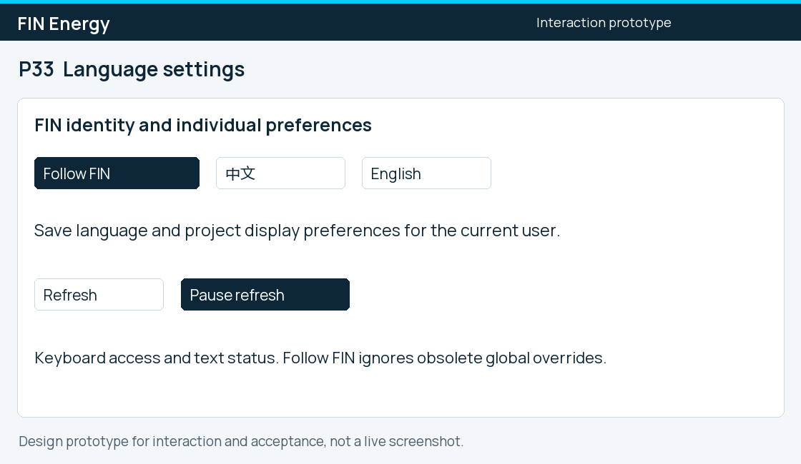

Use FIN user language by default. Save manual preference per user. The native menu follows FIN, and the language registry supports extension.

Use FIN Energy, native menu localization and user-scoped language preferences. Retain Follow FIN and manual switching.

**Evidence boundary** Prior 0.14.37 reference: C VA34. Its original version and scenario apply. Candidate source and controlled tests are recorded separately; historical references are not 0.16 runtime passes.

## P34 English interface

NFR-02 / AC 24

English captures cover overview, comparison controls and the time face. Exports use the frozen language. Unsupported languages fall back to English.

Apply FIN Energy, Manrope and J2 colors. Preserve user names; English demonstrations use English business data.

**Evidence boundary** Prior 0.14.37 reference: C VA34; F1-3. Its original version and scenario apply. Candidate source and controlled tests are recorded separately; historical references are not 0.16 runtime passes.

## P35 Original names and English example

NFR-03 / AC 24

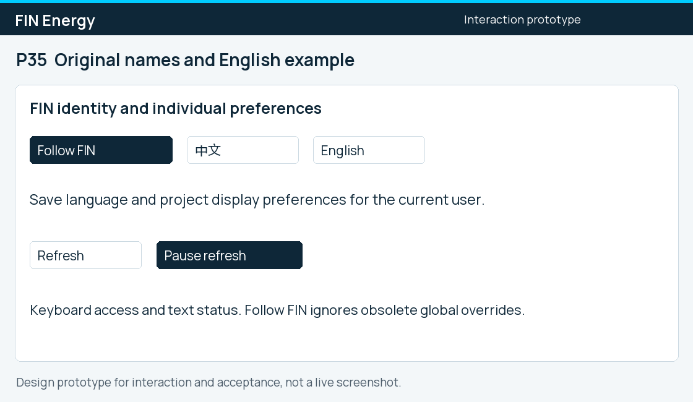

Business names retain the project values. The teaching views show English names including Guide Campus.

**Evidence boundary** Prior 0.14.37 reference: C VA34; F1-3. Its original version and scenario apply. Candidate source and controlled tests are recorded separately; historical references are not 0.16 runtime passes.

## P36 Desktop layout

NFR-04 / AC 25,28

Controlled 1920 and 1366 evidence is recorded separately. Native teaching captures show a 1440-pixel desktop with summaries and scrollable evidence.

**Evidence boundary** Prior 0.14.37 reference: C VA16/17; F1. Its original version and scenario apply. Candidate source and controlled tests are recorded separately; historical references are not 0.16 runtime passes.

## P37 Mobile reflow

NFR-05 / AC 25

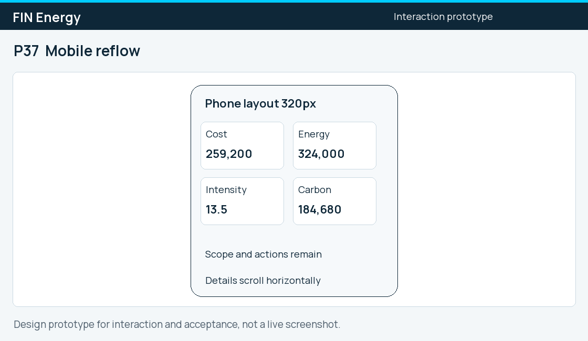

At 390 pixels, cards form a 2×2 grid and main content reflows to one column. Expandable summaries and local table scrolling preserve access.

**Evidence boundary** Prior 0.14.37 reference: C VA18/19. Its original version and scenario apply. Candidate source and controlled tests are recorded separately; historical references are not 0.16 runtime passes.

## P38 Keyboard and text equivalents

NFR-06 / AC 26

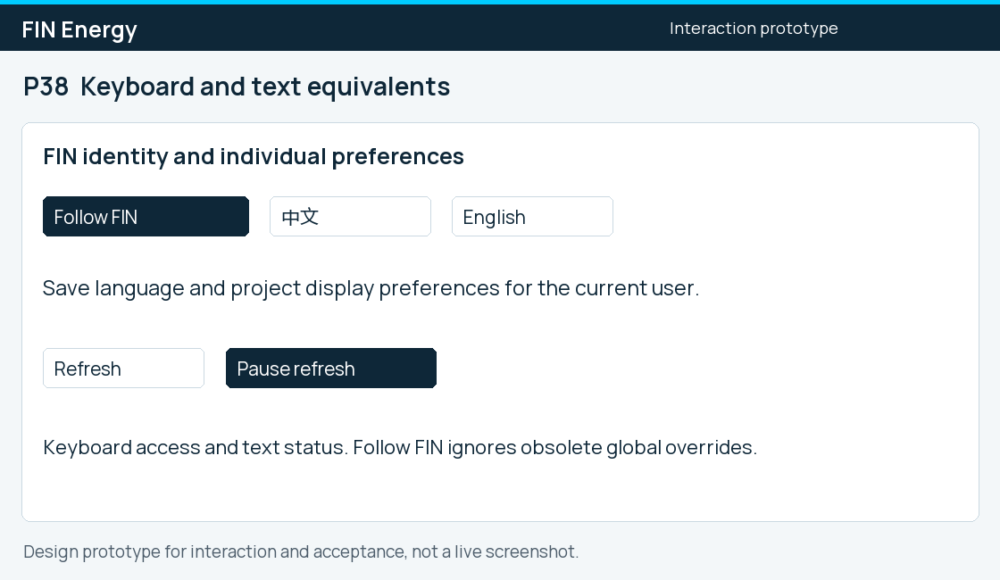

Faces support keyboard and selected-state semantics. Charts retain precise values and textual evidence.

**Evidence boundary** Prior 0.14.37 reference: C VA21/22. Its original version and scenario apply. Candidate source and controlled tests are recorded separately; historical references are not 0.16 runtime passes.

## P39 Refresh and pause

NFR-07 / AC 27,33

Manual is the default. Automatic refresh starts at five minutes with tab coordination. Route, visibility, export and session states govern pauses.

Refresh semantics are unchanged. Migrate eligible user/project preferences without reviving global language overrides.

**Evidence boundary** Prior 0.14.37 reference: C M4R01/02/03. Its original version and scenario apply. Candidate source and controlled tests are recorded separately; historical references are not 0.16 runtime passes.

## P40 Reuse the snapshot

NFR-08 / AC 27,28

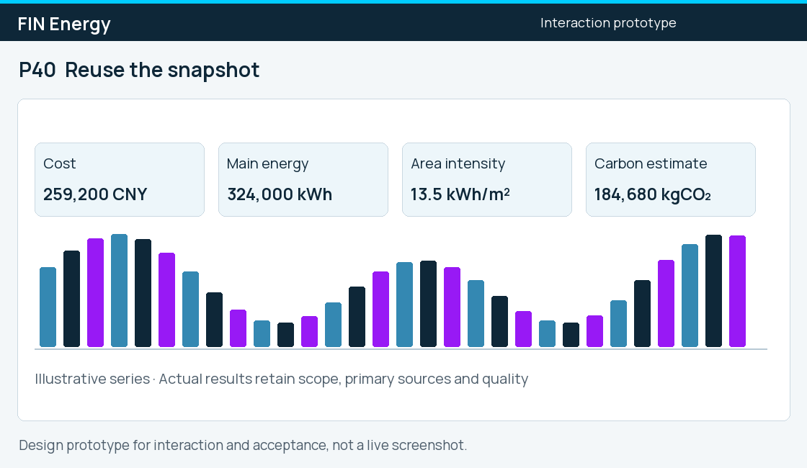

Faces reuse the response. History windows and facts are prepared within one request, and report references resolve in the package.

**Evidence boundary** Prior 0.14.37 reference: C replay; I. Its original version and scenario apply. Candidate source and controlled tests are recorded separately; historical references are not 0.16 runtime passes.

## P41 Stale requests and session expiry

NFR-09 / AC 12,13,23,27

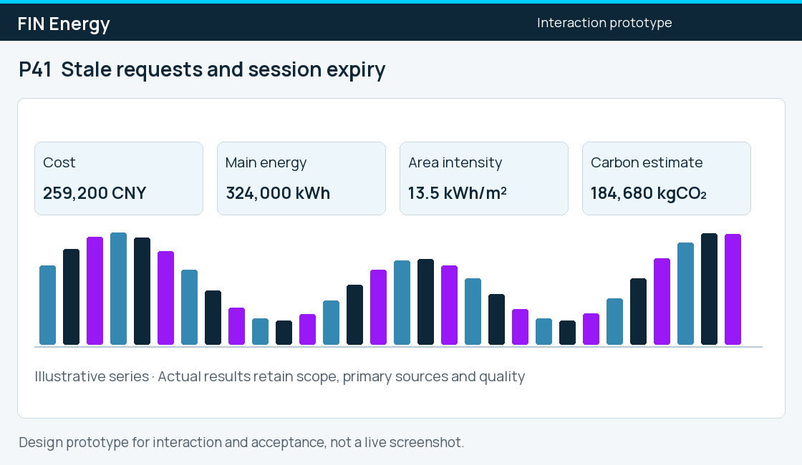

Sequencing and cancellation reject late responses. Failure keeps the prior snapshot and retry. Expiry returns to the FIN session flow.

 Whole-extension license failure is not ordinary module degradation; other modules are not guaranteed to query.

**Evidence boundary** Prior 0.14.37 reference: C VA36. Its original version and scenario apply. Candidate source and controlled tests are recorded separately; historical references are not 0.16 runtime passes.

## P42 Native FIN integration and access

INT-01 / AC 10,23,27

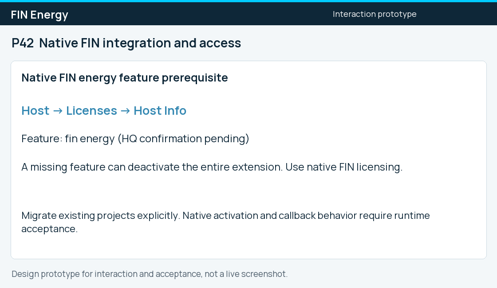

The dedicated menu opens the current FIN project. The cockpit uses native session, relationships and primary history through a read-only query.

Native energy authorization and explicit legacy migration are prerequisites. A missing feature can disable the entire extension; recover through native FIN Host licensing.

**Evidence boundary** Prior 0.14.37 reference: F1; I. Its original version and scenario apply. Candidate source and controlled tests are recorded separately; historical references are not 0.16 runtime passes.

## P43 Time face

EX-01 / AC 02,19

The 24-hour chart shows mean energy by hour in units such as kWh. Complete-day heatmap and calendar reports retain their prerequisites.

**Evidence boundary** Prior 0.14.37 reference: C VA23/24; F3. Its original version and scenario apply. Candidate source and controlled tests are recorded separately; historical references are not 0.16 runtime passes.

## P44 End-use face

EX-02 / AC 02,20

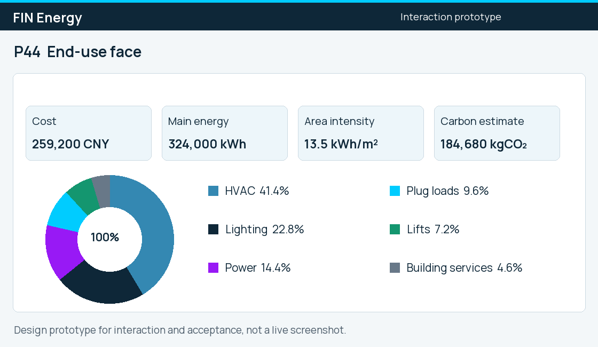

Group the cockpit's canonical effective meters by end use using their own primaries. Show unassigned usage and omit ineligible shares.

**Evidence boundary** Prior 0.14.37 reference: C VA25/26; Q. Its original version and scenario apply. Candidate source and controlled tests are recorded separately; historical references are not 0.16 runtime passes.

## P45 Organization face

EX-03 / AC 02,15

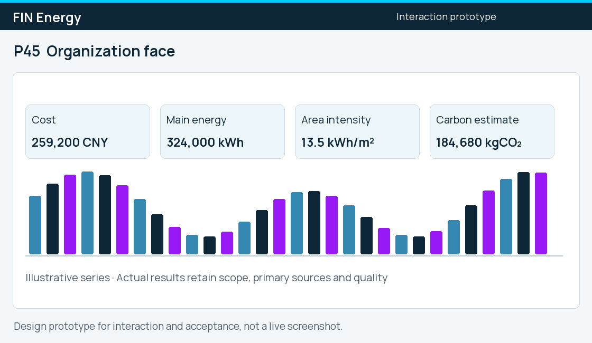

Show the current responsibility hierarchy and unassigned bucket. Parent and child levels retain separate aggregation.

**Evidence boundary** Prior 0.14.37 reference: C VA27. Its original version and scenario apply. Candidate source and controlled tests are recorded separately; historical references are not 0.16 runtime passes.

## P46 Efficiency face

EX-04 / AC 02,08

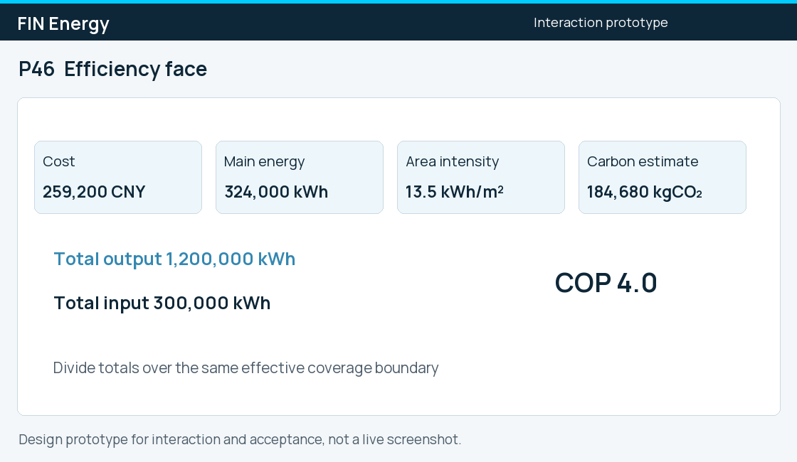

Divide total output by total input within the boundary. Configuration, completeness, units and denominator determine availability.

**Evidence boundary** Prior 0.14.37 reference: C VA28/29. Its original version and scenario apply. Candidate source and controlled tests are recorded separately; historical references are not 0.16 runtime passes.

## P47 Metering balance face

EX-05 / AC 02,16,20

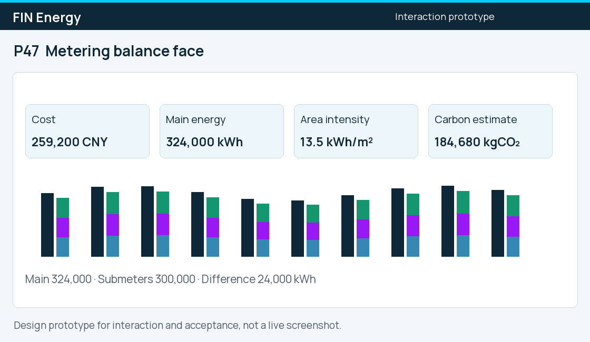

A concise flow links to full flow. The face separates meter differences, coverage and shared references.

**Evidence boundary** Prior 0.14.37 reference: C VA30/31. Its original version and scenario apply. Candidate source and controlled tests are recorded separately; historical references are not 0.16 runtime passes.

## P48 Single-site overview

EX-06 / AC 01,04

Default to the actual readable site, with real hierarchy and related equipment.

**Evidence boundary** Prior 0.14.37 reference: C VA32; F1. Its original version and scenario apply. Candidate source and controlled tests are recorded separately; historical references are not 0.16 runtime passes.

## P49 Multiple sites in one project

EX-07 / AC 01,04,15

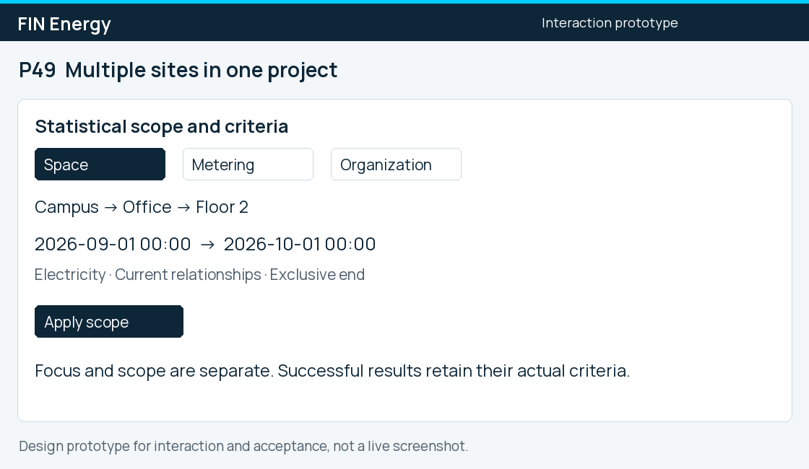

Select one or several readable sites in the same FIN project. Aggregate by the canonical meters and metering boundary.

**Evidence boundary** Prior 0.14.37 reference: C VA33. Its original version and scenario apply. Candidate source and controlled tests are recorded separately; historical references are not 0.16 runtime passes.

## P50 First use and missing configuration

EX-08 / AC 08,13,23

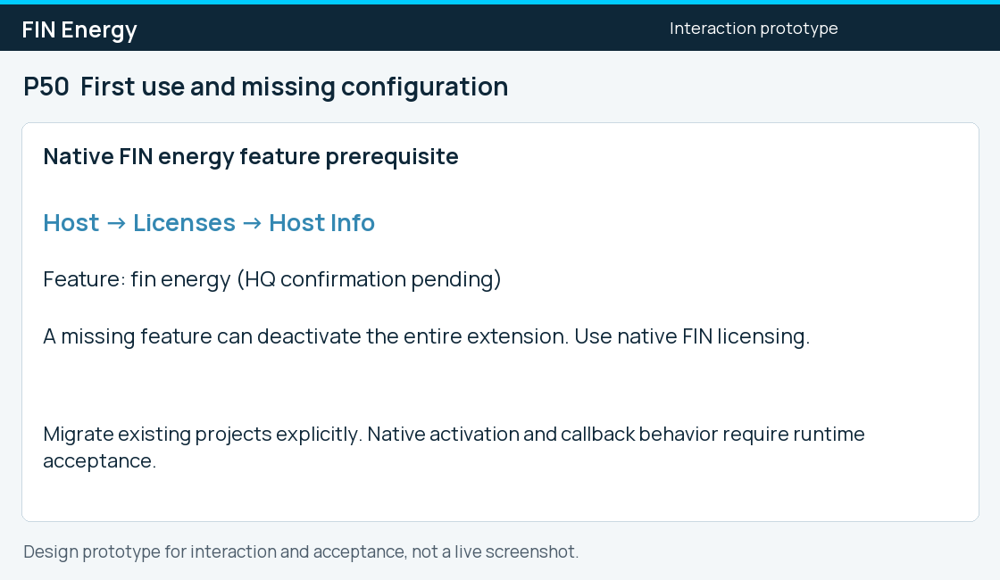

Identify missing points, history, permissions or capability in the relevant state. Managers receive configuration access.

Distinguish native-feature and migration prerequisites from ordinary partial configuration gaps.

**Evidence boundary** Prior 0.14.37 reference: I. Its original version and scenario apply. Candidate source and controlled tests are recorded separately; historical references are not 0.16 runtime passes.

## P51 Module failure and prior snapshot

EX-09 / AC 12,13

A module error leaves other modules usable. A request error retains the prior package with its own title and scope and permits explicit refresh.

 Whole-extension license failure is not ordinary module degradation; other modules are not guaranteed to query.

**Evidence boundary** Prior 0.14.37 reference: C VA36. Its original version and scenario apply. Candidate source and controlled tests are recorded separately; historical references are not 0.16 runtime passes.

## P52 Project assets and hotspots

EX-10 / AC 23,34

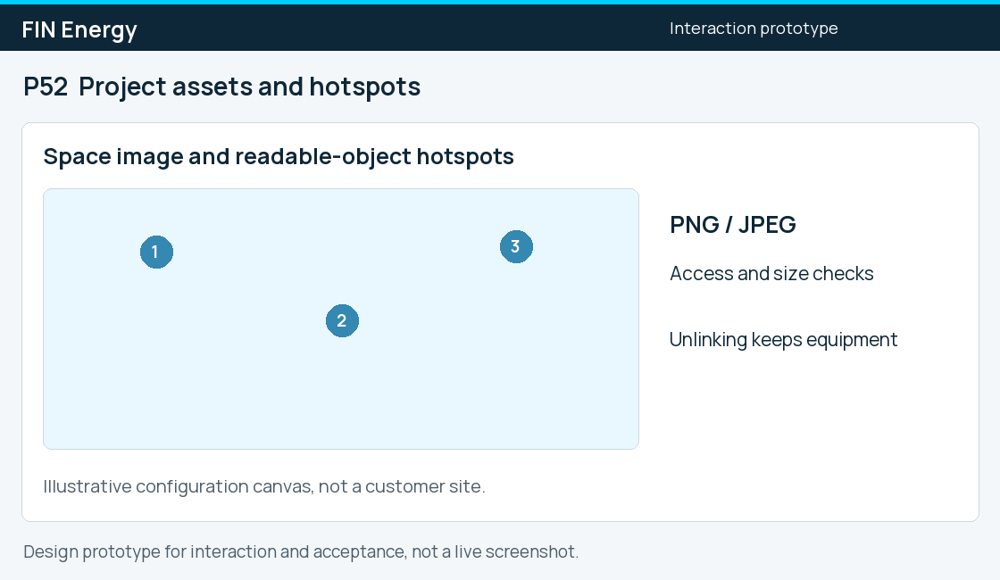

Validate PNG/JPEG, capacity and access. Hotspots reference readable spaces. Unlink/delete applies to the asset. Real read-only acceptance is deferred.

 Migration retains original IDs and updates owned tags, structured snapshots, alarms and asset paths through the original journal. Deferred native read-only scenarios still require target FIN verification.

**Evidence boundary** Prior 0.14.37 reference: C M4A01/03; D M4A02. Its original version and scenario apply. Candidate source and controlled tests are recorded separately; historical references are not 0.16 runtime passes.

## P53 320-pixel phone layout

EX-11 / AC 25

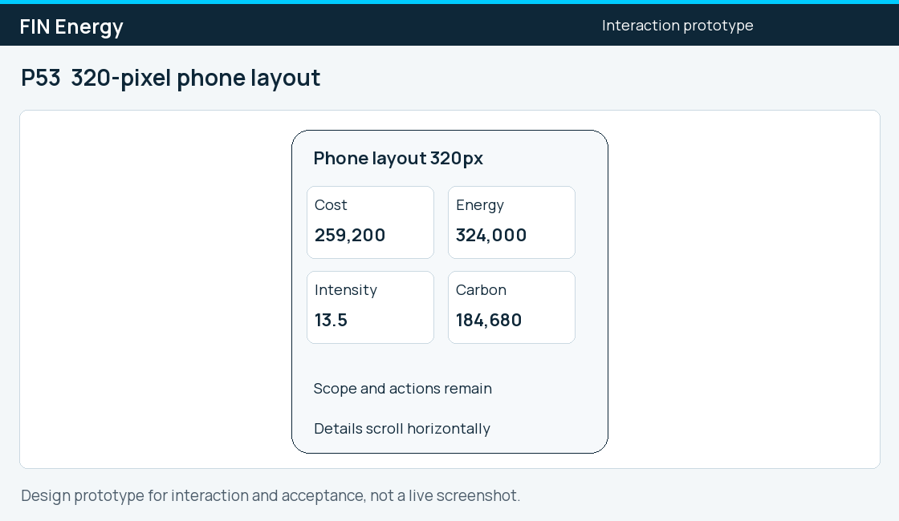

Controlled narrow-width coverage preserves paired values, controls and scrollable details. The release records the viewport size.

**Evidence boundary** Prior 0.14.37 reference: C VA20. Its original version and scenario apply. Candidate source and controlled tests are recorded separately; historical references are not 0.16 runtime passes.

## P54 Hourly threshold and episode merging

EX-12 / AC 09,21

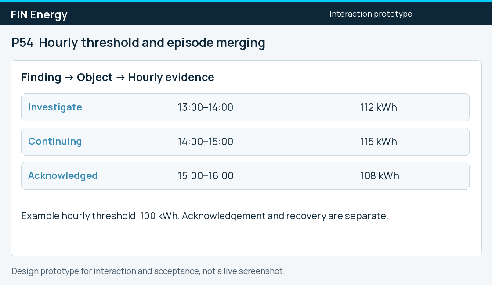

Evaluate complete-hour usage in the energy unit, with enablement, threshold, valid history and scan. Consecutive exceedances form an episode.

**Evidence boundary** Prior 0.14.37 reference: I. Its original version and scenario apply. Candidate source and controlled tests are recorded separately; historical references are not 0.16 runtime passes.

## P55 Cleaning and anomaly treatment

EX-13 / AC 17,18,19

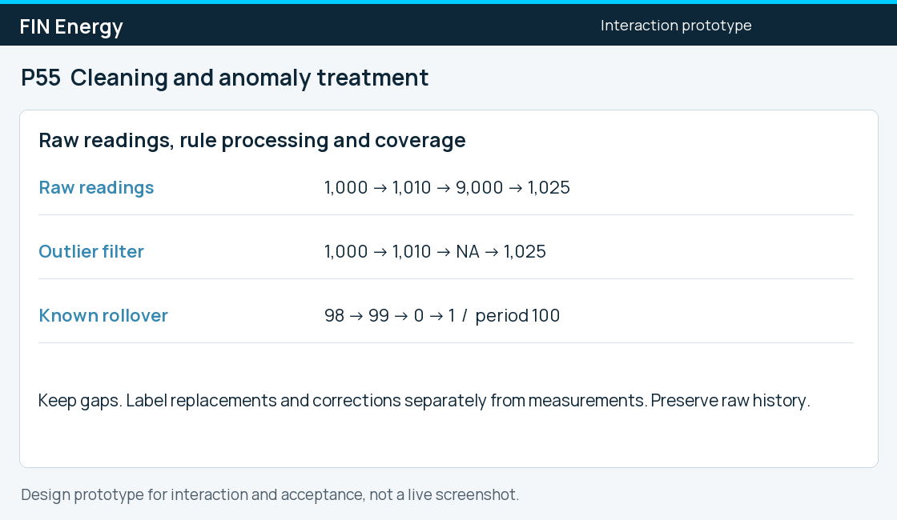

Filter, substitute a configured value or NA, or correct a supported rollover at read time. Keep original history and diagnostics.

Raw history remains. Normal/raw history and hisFunc availability after native deactivation require genuine FIN runtime acceptance.

**Evidence boundary** Prior 0.14.37 reference: I. Its original version and scenario apply. Candidate source and controlled tests are recorded separately; historical references are not 0.16 runtime passes.

## Native License and Upgrade Acceptance

After HQ confirms the exact feature and provides a genuine grant, use isolated FIN to test active/missing/expired/restarted and multi-project states, normal/raw history and cleaning callbacks. For existing projects preview, apply the reviewed revision and inspect the original journal and persistent maintenance state. Resume/rollback preserve current values and acknowledgements. Compare identical scopes, primaries, periods and cleaning for consumption, end uses, costs and differences, and verify one job set. Free meters and training grants remain proposals.
