# FIN 能源管理驾驶舱需求与原型

FIN 能源管理 0.16.0 候选版 · 2026-11-20

本版逐项保留 P01–P55、原需求编号和验收编号，按0.16.0候选源码更新品牌、原生授权、偏好与迁移。每项配套重新绘制的 J2 风格交互原型；原型不是已部署界面或运行证明。既有逻辑沿用当前代码，不把55项全部描述为本次新增。

## P01 日常进入驾驶舱

SC-01 / AC 01,06

进入总览自动提交当前可读范围和本月。截止为 FIN 查询时刻。新原型为交互说明。

**证据边界** 原0.14.37记录：C VA01; F1。仅按该历史版本及场景理解；本次候选源码和受控测试记录另列，不整体升级为0.16实机通过。

## P02 从发现到证据

SC-02 / AC 03,05,09

从空间焦点或重点事项进入核查。事件独立保留身份、对象和小时证据区间。

**证据边界** 原0.14.37记录：I。仅按该历史版本及场景理解；本次候选源码和受控测试记录另列，不整体升级为0.16实机通过。

## P03 同快照领导汇报

SC-03 / AC 14

领导汇报复用已生效快照。展示经营参照、结论与质量，缺预算按可比参照条件显示。

**证据边界** 原0.14.37记录：C VA12/13。仅按该历史版本及场景理解；本次候选源码和受控测试记录另列，不整体升级为0.16实机通过。

## P04 项目范围和时间选择

FR-01 / AC 01,04

统计范围按当前 FIN 项目选择。支持今日、本月、本年、自定义。应用后切换生效范围，显示时区及结束不含。

**证据边界** 原0.14.37记录：C VA33/36; F2。仅按该历史版本及场景理解；本次候选源码和受控测试记录另列，不整体升级为0.16实机通过。

## P05 关注能源切换

FR-02 / AC 02,07

主能源单选，决定相关指标和面。可选辅助分类或单位面积，分别保留能源单位。

**证据边界** 原0.14.37记录：I。仅按该历史版本及场景理解；本次候选源码和受控测试记录另列，不整体升级为0.16实机通过。

## P06 四项指标与配置降级

FR-03 / AC 07,08

固定顺序为费用、主能源量、辅助能源或面积强度、碳排或未恢复事件。缺项显示原因。

**证据边界** 原0.14.37记录：C VA02; F1。仅按该历史版本及场景理解；本次候选源码和受控测试记录另列，不整体升级为0.16实机通过。

## P07 管理结论与依据

FR-04 / AC 11,14

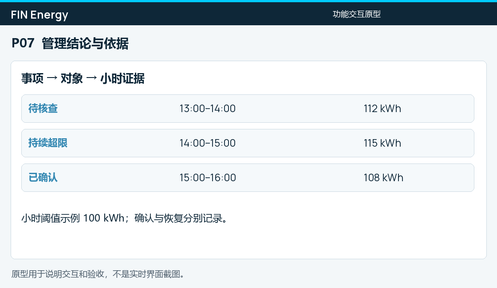

精简结论按可比变化、数据限制和当前事件规则生成。展开查看规则、值和有效区间。

**证据边界** 原0.14.37记录：C VA03; F1。仅按该历史版本及场景理解；本次候选源码和受控测试记录另列，不整体升级为0.16实机通过。

## P08 首页信息层级

FR-05 / AC 01,02

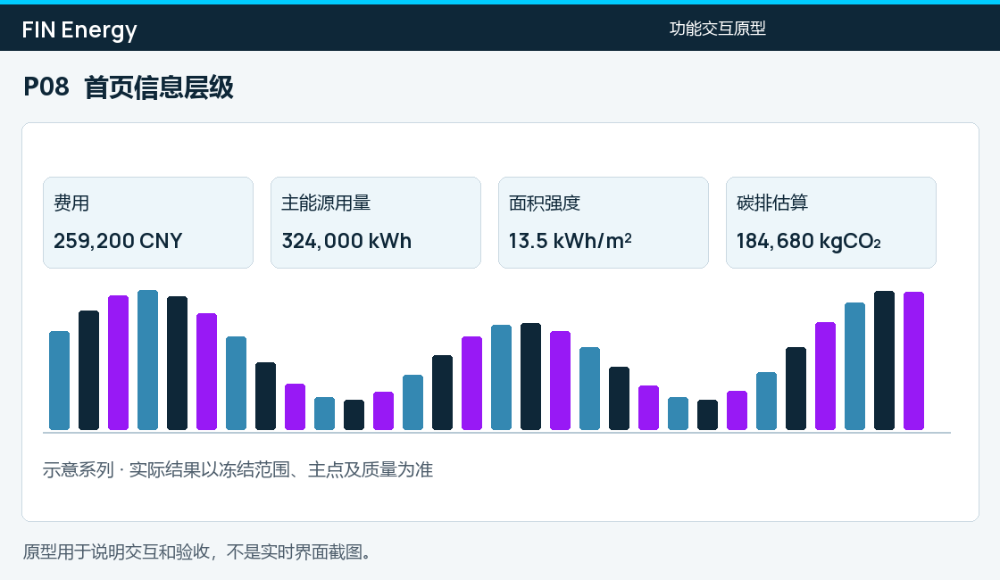

前部显示管理结论及固定四卡，经营参照、观察面和重点核查分栏，趋势与去向承接。

**证据边界** 原0.14.37记录：C VA01/04/06; F1。仅按该历史版本及场景理解；本次候选源码和受控测试记录另列，不整体升级为0.16实机通过。

## P09 范围和焦点分离

FR-06 / AC 03,04,12

选中对象只改变焦点。明确设为统计范围才提交，加载和失败时显示原快照所属范围。

**证据边界** 原0.14.37记录：C VA08/10/36。仅按该历史版本及场景理解；本次候选源码和受控测试记录另列，不整体升级为0.16实机通过。

## P10 空间示意和列表

FR-07 / AC 02,26

使用实际 Site/Floor 与对象路径，列表和等距示意关联同一空间。缺适用层级时使用可读列表。

**证据边界** 原0.14.37记录：C VA07; F1。仅按该历史版本及场景理解；本次候选源码和受控测试记录另列，不整体升级为0.16实机通过。

## P11 核查对象与表计关联

FR-08 / AC 03,16

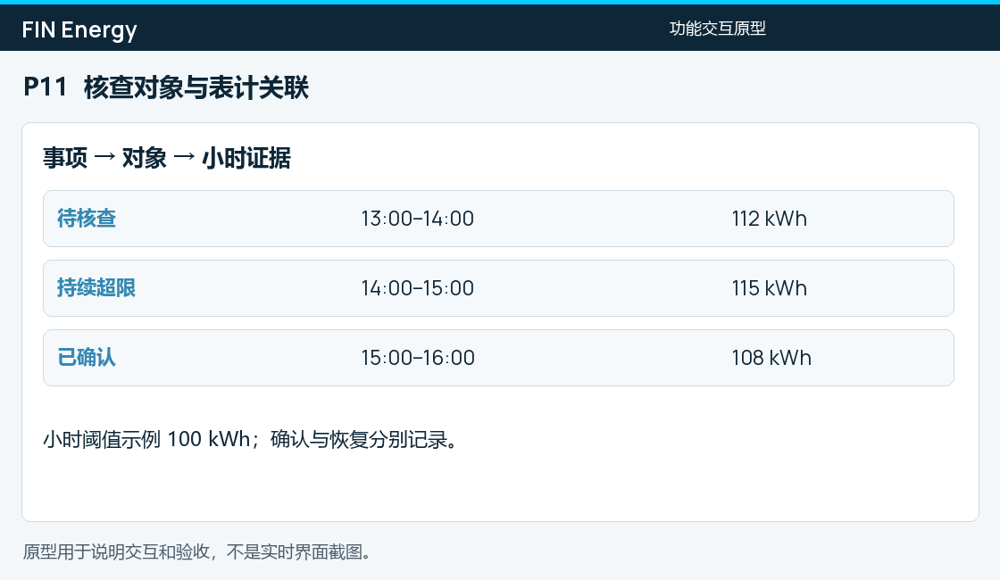

空间焦点可查看用量口径、实际设备关联和来源。不明确的关系通过质量或缺项说明。

**证据边界** 原0.14.37记录：C VA09。仅按该历史版本及场景理解；本次候选源码和受控测试记录另列，不整体升级为0.16实机通过。

## P12 下钻与返回

FR-09 / AC 05,14

传递绝对起止、截止、能源及有效范围。返回前核对用户、项目、可读性与配置，恢复原视图。

**证据边界** 原0.14.37记录：C VA11/31。仅按该历史版本及场景理解；本次候选源码和受控测试记录另列，不整体升级为0.16实机通过。

## P13 连续事件小时证据

FR-10 / AC 05,09,21

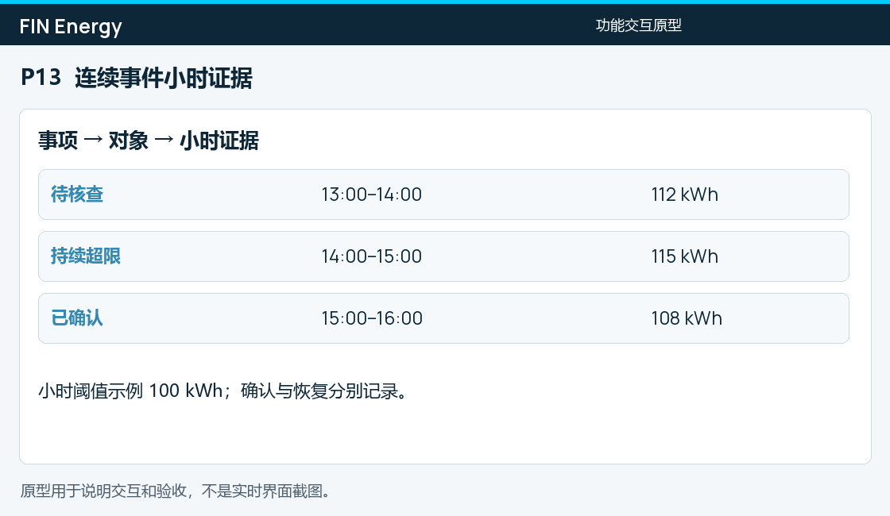

按事件身份查看有效小时用量与阈值。连续小时归同一事件。能耗单位与瞬时功率分别处理。

**证据边界** 原0.14.37记录：I。仅按该历史版本及场景理解；本次候选源码和受控测试记录另列，不整体升级为0.16实机通过。

## P14 报警、线索与数据问题

FR-11 / AC 09,10

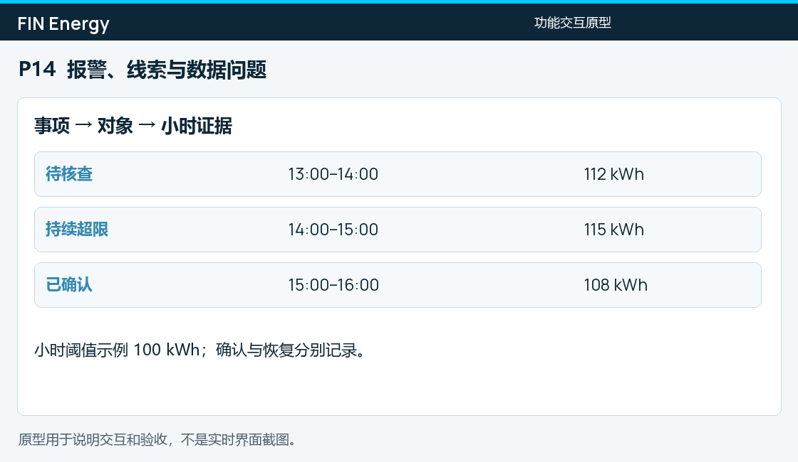

正式报警、规则核查线索和数据质量问题分类展示，规则评估产生线索及依据。

**证据边界** 原0.14.37记录：C M4C03。仅按该历史版本及场景理解；本次候选源码和受控测试记录另列，不整体升级为0.16实机通过。

## P15 事件详情和当前状态

FR-12 / AC 09,10

事件时间与状态观察时间分开。确认、恢复各自记录，早于所选能耗区间的未恢复事件仍可符合当前范围。

**证据边界** 原0.14.37记录：I。仅按该历史版本及场景理解；本次候选源码和受控测试记录另列，不整体升级为0.16实机通过。

## P16 重点事项排序

FR-13 / AC 09,16

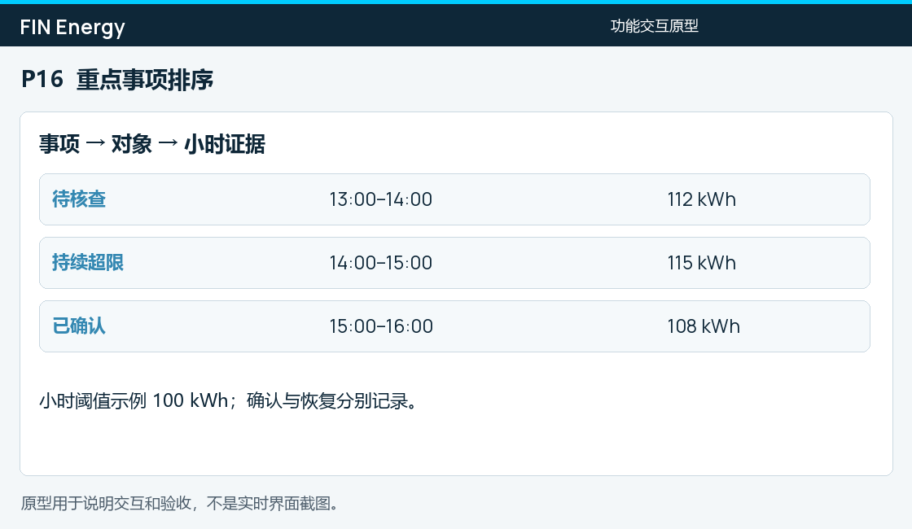

首屏简短显示前三项，展开继续按既定顺序核查，质量阻断也在对应指标标明。

**证据边界** 原0.14.37记录：C VA05。仅按该历史版本及场景理解；本次候选源码和受控测试记录另列，不整体升级为0.16实机通过。

## P17 原生报警关联

FR-14 / AC 09,10,23

沿用事件与 FIN 原生报警关联。消息中心按事件定位，确认流程独立于驾驶舱只读查询。

 迁移保留原ID，产品标签、结构化快照、报警及素材路径按原日志更新。

**证据边界** 原0.14.37记录：I。仅按该历史版本及场景理解；本次候选源码和受控测试记录另列，不整体升级为0.16实机通过。

## P18 统计边界与去重

DATA-01 / AC 15

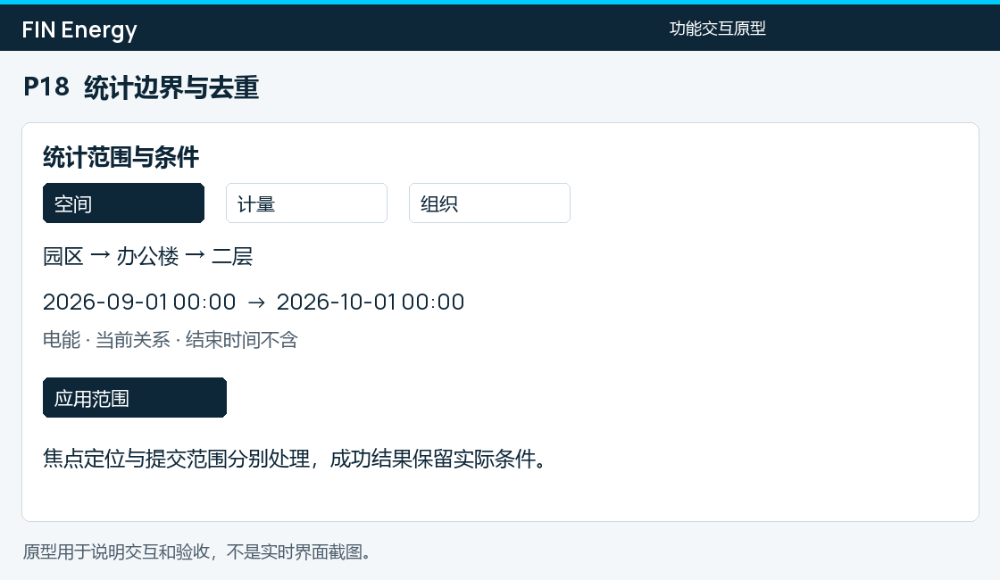

用当前关系解析规范表计与明确主点。重叠显式对象保留自身值及理由，省略不可靠的混合合计。

**证据边界** 原0.14.37记录：C VA26/33; Q。仅按该历史版本及场景理解；本次候选源码和受控测试记录另列，不整体升级为0.16实机通过。

## P19 差额及缺测降级

DATA-02 / AC 16,20

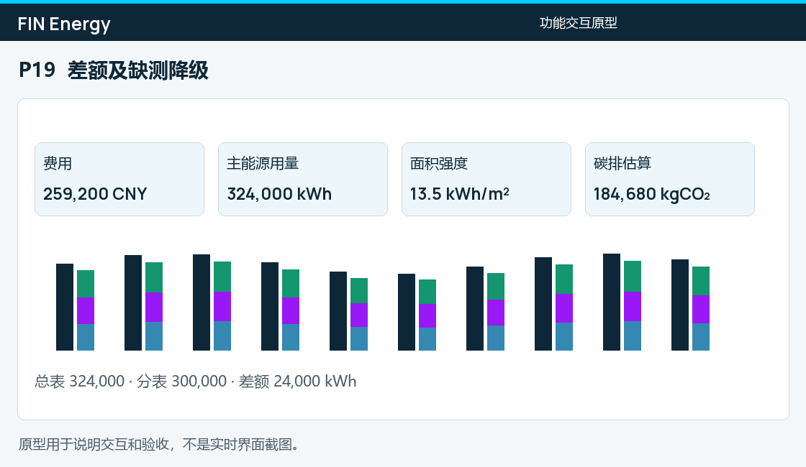

已有量差额与完整差额分列，分母为总表。覆盖不足保留诊断。负差额保留符号。

**证据边界** 原0.14.37记录：C VA26/30。仅按该历史版本及场景理解；本次候选源码和受控测试记录另列，不整体升级为0.16实机通过。

## P20 精度、真实零值与 NA

DATA-03 / AC 19,20

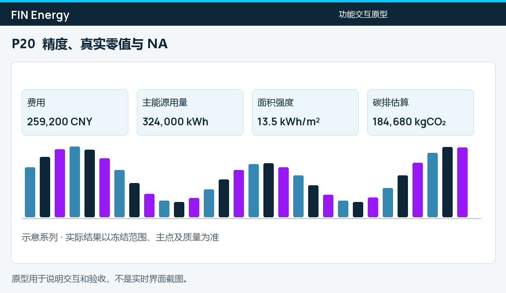

显示精度独立于底层值。真实零、NA 和缺测区分，详情或导出携带精确值和来源。

**证据边界** 原0.14.37记录：C VA22。仅按该历史版本及场景理解；本次候选源码和受控测试记录另列，不整体升级为0.16实机通过。

## P21 完整小时与区间边界

DATA-04 / AC 01,22

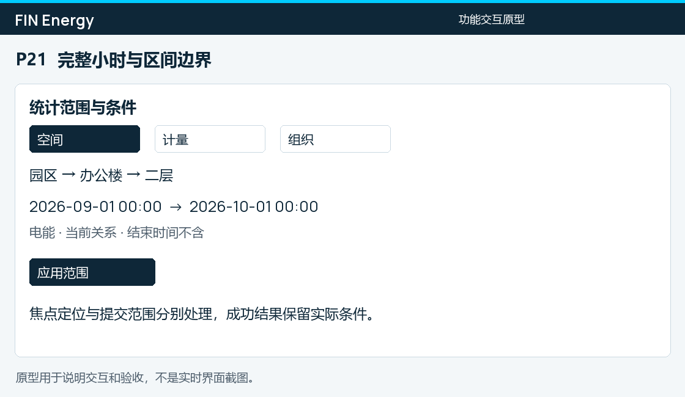

查询不退到整点，本月截至 FIN 服务器查询时刻。已有量标明末段质量。热力、小时规则保留完整性约束。

**证据边界** 原0.14.37记录：C VA23; Q。仅按该历史版本及场景理解；本次候选源码和受控测试记录另列，不整体升级为0.16实机通过。

## P22 同比环比和特殊日期

DATA-05 / AC 11,22

本月/本年默认同比，今日默认前日同刻。本月和自定义可选环比，边界前移一个自然月，显示月末/DST调整。

**证据边界** 原0.14.37记录：F2; I。仅按该历史版本及场景理解；本次候选源码和受控测试记录另列，不整体升级为0.16实机通过。

## P23 没有可比同期

DATA-06 / AC 11

缺同期、替代、不兼容及参照零值使用各自原因。按选择的模式保留参照，缺少可比性时省略百分比。

**证据边界** 原0.14.37记录：I。仅按该历史版本及场景理解；本次候选源码和受控测试记录另列，不整体升级为0.16实机通过。

## P24 模块级覆盖

FR-15 / AC 16,17,18

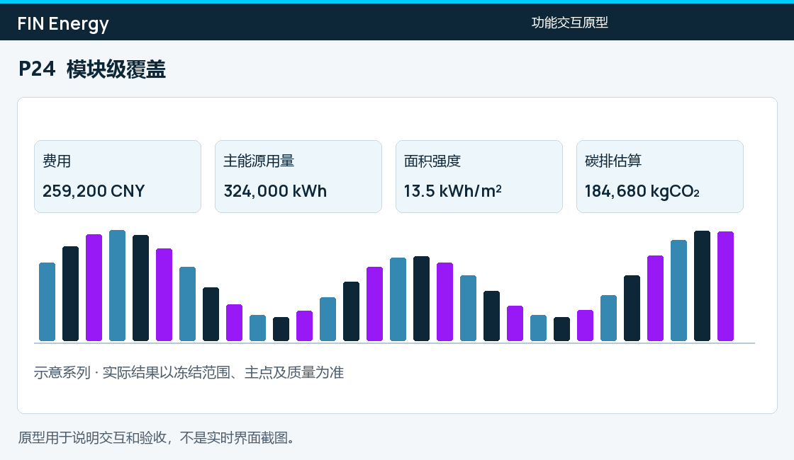

首屏用短摘要，展开覆盖和清洗。某模块缺历史或配置时仍可查看其他已成功模块。

 整个扩展的授权不可用不属于普通模块降级，不能承诺其他模块仍可查询。

**证据边界** 原0.14.37记录：C VA35。仅按该历史版本及场景理解；本次候选源码和受控测试记录另列，不整体升级为0.16实机通过。

## P25 数据来源及清洗追溯

FR-16 / AC 17,18,19

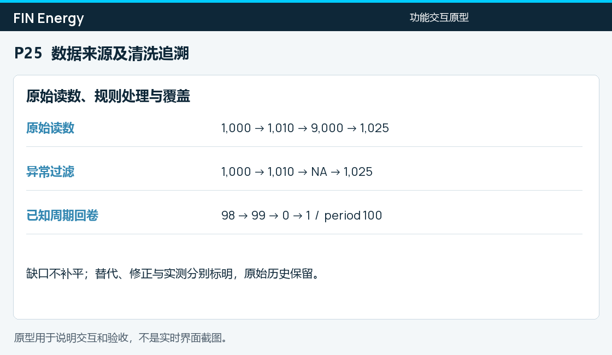

提供主点、清洗快照、过滤、替代、回卷及覆盖证据。区分全量统计与受限诊断。

 迁移保留原ID，产品标签、结构化快照、报警及素材路径按原日志更新。

**证据边界** 原0.14.37记录：C VA35; I。仅按该历史版本及场景理解；本次候选源码和受控测试记录另列，不整体升级为0.16实机通过。

## P26 期间预算与校验

FR-17 / AC 29,31,32

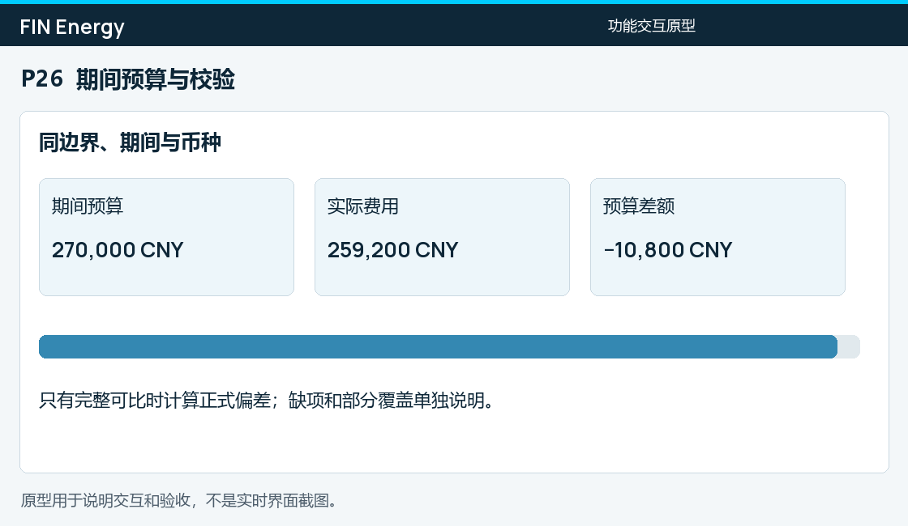

匹配范围、能源、币种及月份。逐日金额对齐总额，DST 以实际本地日时长分配。

 迁移保留原ID，产品标签、结构化快照、报警及素材路径按原日志更新。

**证据边界** 原0.14.37记录：C M4B02/04。仅按该历史版本及场景理解；本次候选源码和受控测试记录另列，不整体升级为0.16实机通过。

## P27 预算进度和偏差

FR-18 / AC 29,30

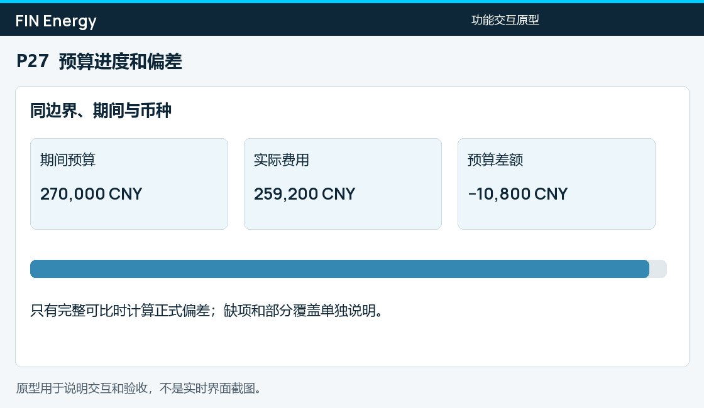

分别显示期间、整月预算、日历进度和费用。严格费用不足时可标已有费用参考，正式偏差保持空。

 迁移保留原ID，产品标签、结构化快照、报警及素材路径按原日志更新。

**证据边界** 原0.14.37记录：C M4B01; X。仅按该历史版本及场景理解；本次候选源码和受控测试记录另列，不整体升级为0.16实机通过。

## P28 缺预算和只读权限

FR-19 / AC 06,23,31

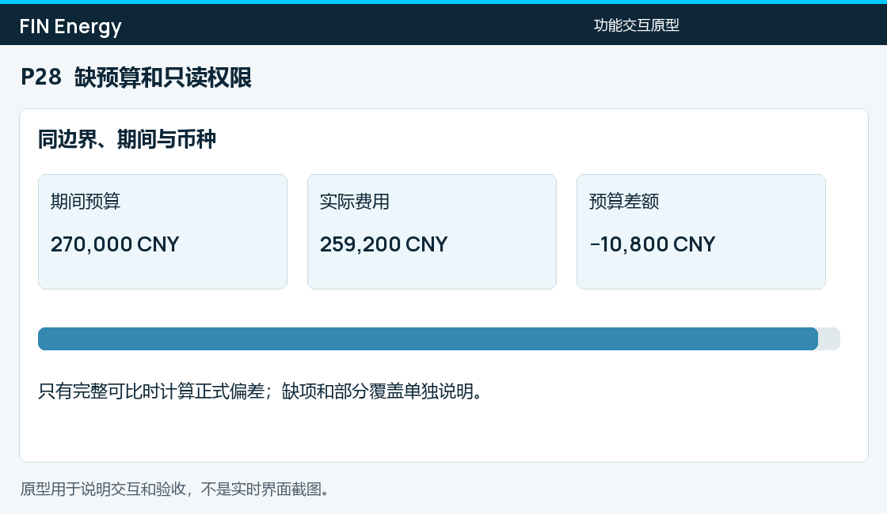

精确边界和币种检查。缺失回退到可比同期，写配置受权限控制。真实只读预算验收延期。

 迁移保留原ID，产品标签、结构化快照、报警及素材路径按原日志更新。 原生只读权限场景的旧待验项目仍需真实FIN核对。

**证据边界** 原0.14.37记录：I; D M4B03。仅按该历史版本及场景理解；本次候选源码和受控测试记录另列，不整体升级为0.16实机通过。

## P29 预算偏差线索

FR-20 / AC 29,31

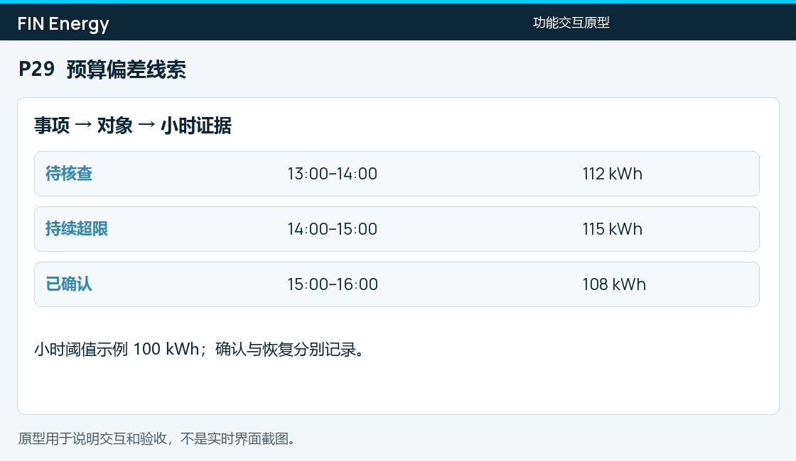

规则依据正式期间偏差、币种、阈值及质量，生成核查线索。已有费用参考独立展示。

 迁移保留原ID，产品标签、结构化快照、报警及素材路径按原日志更新。

**证据边界** 原0.14.37记录：C M4C01/03。仅按该历史版本及场景理解；本次候选源码和受控测试记录另列，不整体升级为0.16实机通过。

## P30 布局共享快照

FR-21 / AC 14

总览和领导汇报共享同一快照与指标。只切换阅读布局。

**证据边界** 原0.14.37记录：C VA13。仅按该历史版本及场景理解；本次候选源码和受控测试记录另列，不整体升级为0.16实机通过。

## P31 全屏汇报和退出

FR-22 / AC 14,26

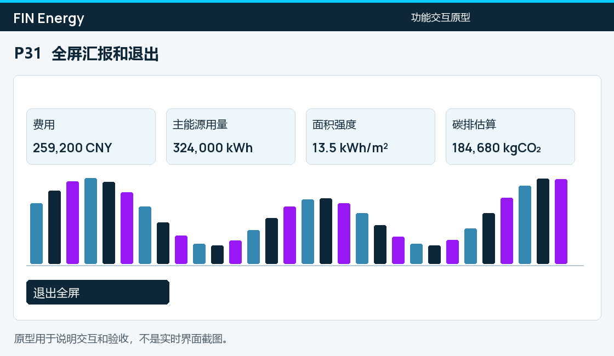

显式进入或退出全屏，保留汇报布局与可用状态。退出恢复此前界面。

**证据边界** 原0.14.37记录：C VA14。仅按该历史版本及场景理解；本次候选源码和受控测试记录另列，不整体升级为0.16实机通过。

## P32 冻结快照导出

FR-23 / AC 14

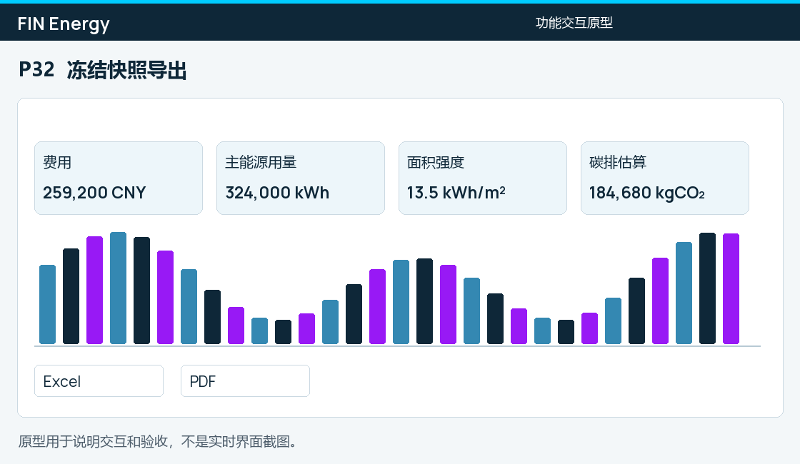

完整汇报冻结范围、比较、质量与语言，支持 Excel、JSON 及打印布局。原生打印/PDF 验收延期。

 导出品牌已更新；受控PDF导出验证不替代原生打印验收。

**证据边界** 原0.14.37记录：I; X; D VA15。仅按该历史版本及场景理解；本次候选源码和受控测试记录另列，不整体升级为0.16实机通过。

## P33 语言设置

NFR-01 / AC 24

默认跟随 FIN 用户语言，手动选择按用户保存，原生菜单按 FIN 用户语言。保留语言注册扩展。

品牌、原生菜单和浏览器标题统一为 FIN 能源管理；默认跟随 FIN 用户，手动切换保留。

**证据边界** 原0.14.37记录：C VA34。仅按该历史版本及场景理解；本次候选源码和受控测试记录另列，不整体升级为0.16实机通过。

## P34 完整英文界面

NFR-02 / AC 24

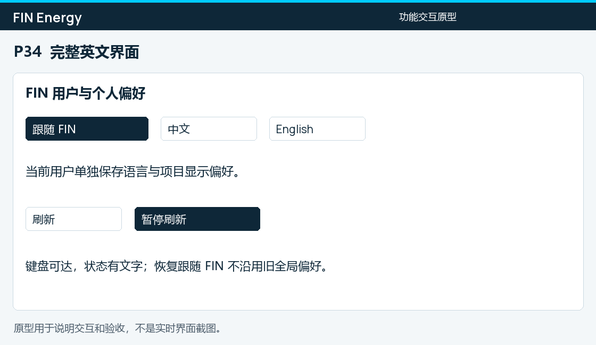

英文截图覆盖驾驶舱、比较控件和时间面。导出标签由冻结语言决定，未支持语言回退英文。

英文使用 FIN Energy、Manrope 和 J2 配色。业务名称保留用户原文；英文演示数据全部使用英文。

**证据边界** 原0.14.37记录：C VA34; F1-3。仅按该历史版本及场景理解；本次候选源码和受控测试记录另列，不整体升级为0.16实机通过。

## P35 业务原名及英文示例

NFR-03 / AC 24

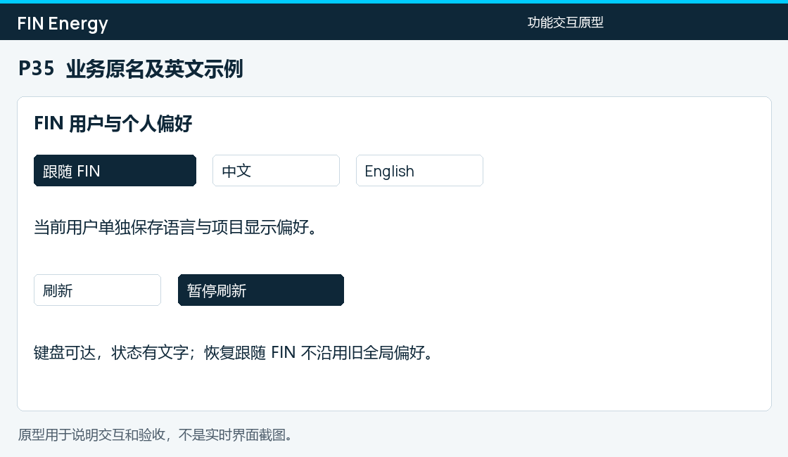

业务名称按项目原文显示。此教学项目画面使用 Guide Campus 等英文业务名称。

**证据边界** 原0.14.37记录：C VA34; F1-3。仅按该历史版本及场景理解；本次候选源码和受控测试记录另列，不整体升级为0.16实机通过。

## P36 桌面布局

NFR-04 / AC 25,28

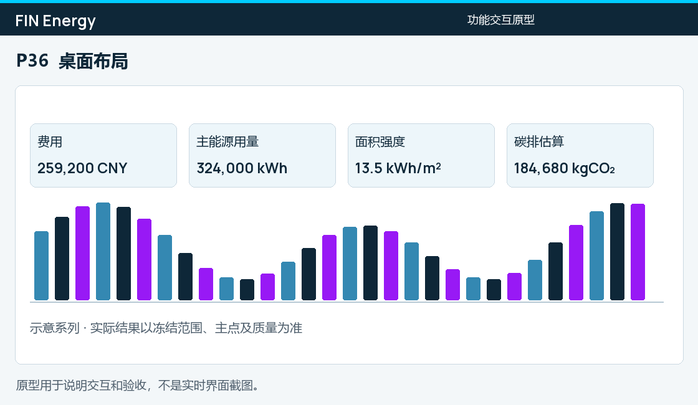

1920 和 1366 的受控证据分列。原生教学截图展示 1440 宽桌面观察，保留摘要和可滚动证据区。

**证据边界** 原0.14.37记录：C VA16/17; F1。仅按该历史版本及场景理解；本次候选源码和受控测试记录另列，不整体升级为0.16实机通过。

## P37 手机重排

NFR-05 / AC 25

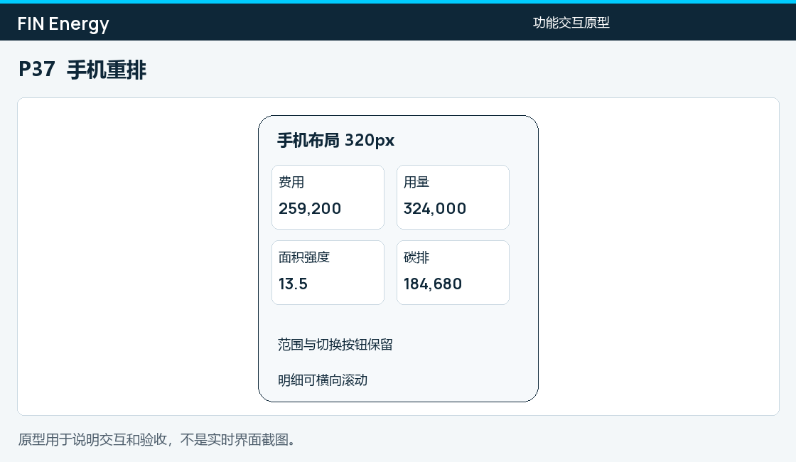

390 像素下四卡 2×2，主体单列重排。可展开摘要和表格，局部滚动保留阅读。

**证据边界** 原0.14.37记录：C VA18/19。仅按该历史版本及场景理解；本次候选源码和受控测试记录另列，不整体升级为0.16实机通过。

## P38 键盘和文字替代

NFR-06 / AC 26

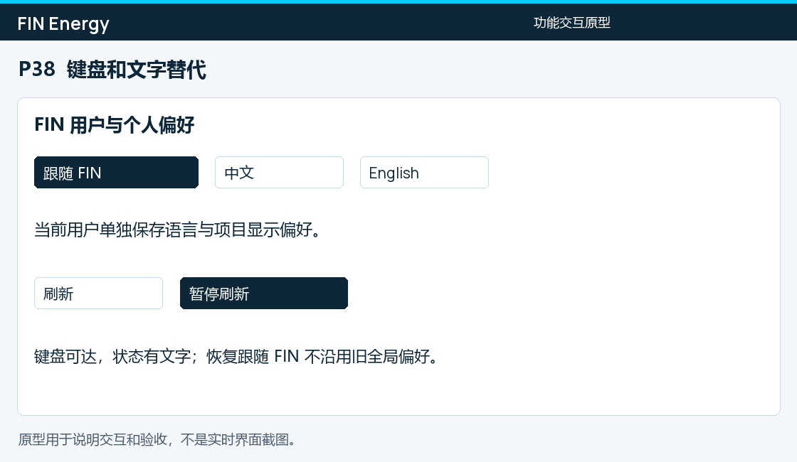

视角支持键盘和选中语义，图表保留精确数值及文字证据。

**证据边界** 原0.14.37记录：C VA21/22。仅按该历史版本及场景理解；本次候选源码和受控测试记录另列，不整体升级为0.16实机通过。

## P39 刷新与暂停

NFR-07 / AC 27,33

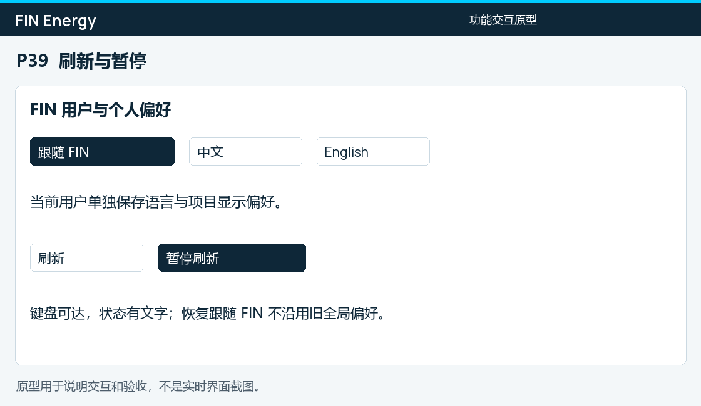

默认手动。自动刷新最短五分钟，跨标签约束。离开、隐藏、导出及会话变化按状态暂停。

刷新语义不变，旧用户／项目显示偏好迁移到新命名；不继承旧全局语言覆盖。

**证据边界** 原0.14.37记录：C M4R01/02/03。仅按该历史版本及场景理解；本次候选源码和受控测试记录另列，不整体升级为0.16实机通过。

## P40 共享快照

NFR-08 / AC 27,28

六面切换复用响应。统一历史窗口计划和请求内事实，报告引用同包结果。

**证据边界** 原0.14.37记录：C replay; I。仅按该历史版本及场景理解；本次候选源码和受控测试记录另列，不整体升级为0.16实机通过。

## P41 新旧请求与会话失效

NFR-09 / AC 12,13,23,27

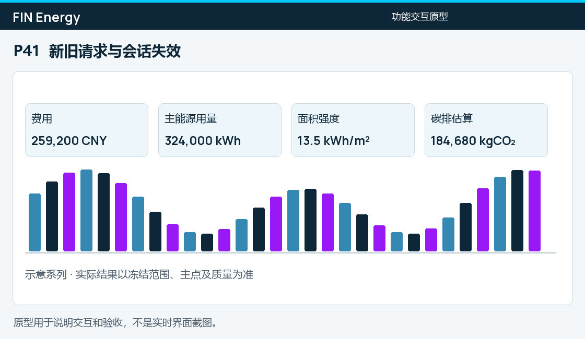

按序号和取消处理挡住迟到响应。请求失败显示原快照与重试入口，会话失效进入 FIN 流程。

 整个扩展的授权不可用不属于普通模块降级，不能承诺其他模块仍可查询。

**证据边界** 原0.14.37记录：C VA36。仅按该历史版本及场景理解；本次候选源码和受控测试记录另列，不整体升级为0.16实机通过。

## P42 原生 FIN 集成和权限

INT-01 / AC 10,23,27

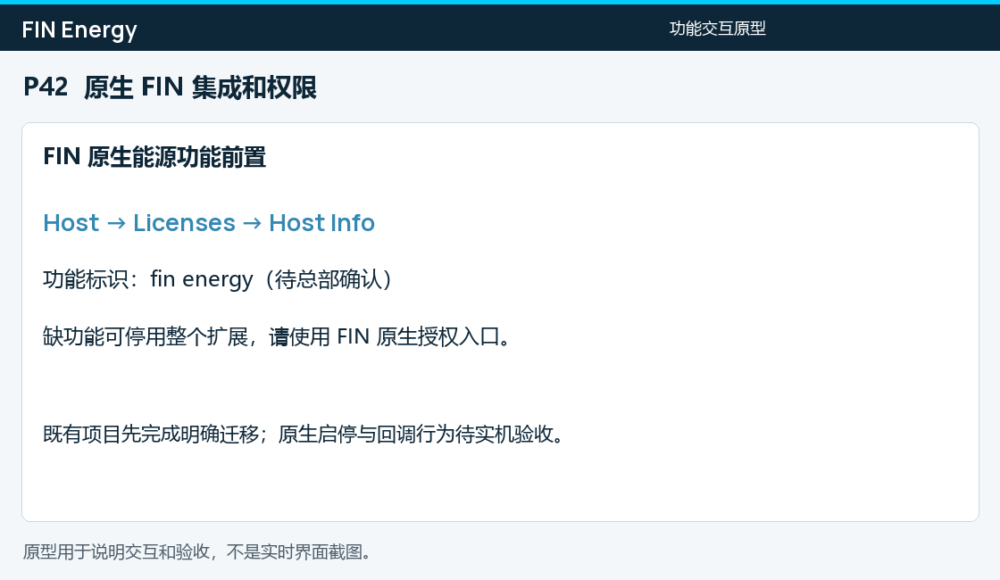

独立菜单进入同一 FIN 项目，复用会话、关系和主点历史。驾驶舱查询只读。

能源功能原生授权与旧配置明确迁移是前置。缺功能时整个扩展可能不可用，请从 FIN 原生 Host 管理授权。

**证据边界** 原0.14.37记录：F1; I。仅按该历史版本及场景理解；本次候选源码和受控测试记录另列，不整体升级为0.16实机通过。

## P43 时间视角

EX-01 / AC 02,19

24 小时柱为对应小时的平均能量，单位 kWh 等。完整日热力、工作日分析有各自证据前提。

**证据边界** 原0.14.37记录：C VA23/24; F3。仅按该历史版本及场景理解；本次候选源码和受控测试记录另列，不整体升级为0.16实机通过。

## P44 用途视角

EX-02 / AC 02,20

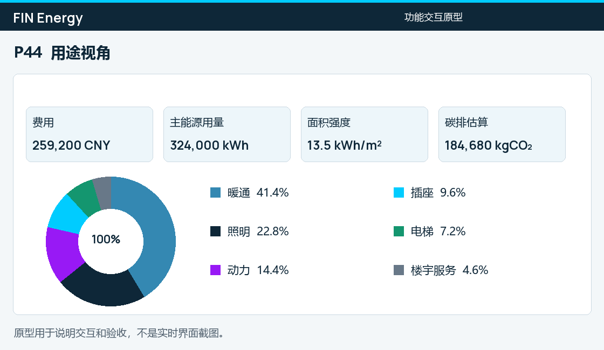

按驾驶舱规范有效表计集合分项，每台取自身主点。未分项单列，可加性不足时省略构成百分比。

**证据边界** 原0.14.37记录：C VA25/26; Q。仅按该历史版本及场景理解；本次候选源码和受控测试记录另列，不整体升级为0.16实机通过。

## P45 组织视角

EX-03 / AC 02,15

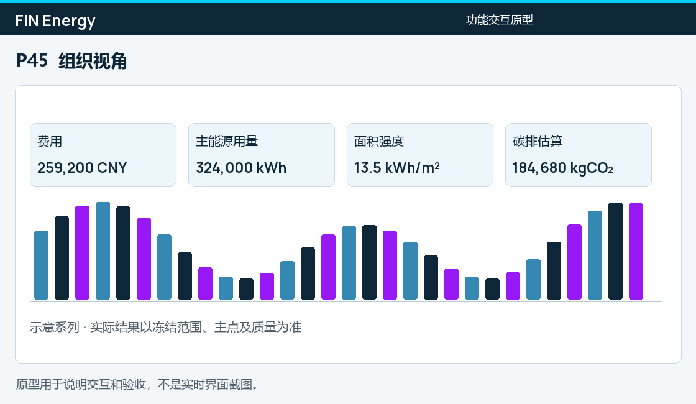

当前责任组织分层与未归属独立展示，父子层级避免混合累计。

**证据边界** 原0.14.37记录：C VA27。仅按该历史版本及场景理解；本次候选源码和受控测试记录另列，不整体升级为0.16实机通过。

## P46 能效视角

EX-04 / AC 02,08

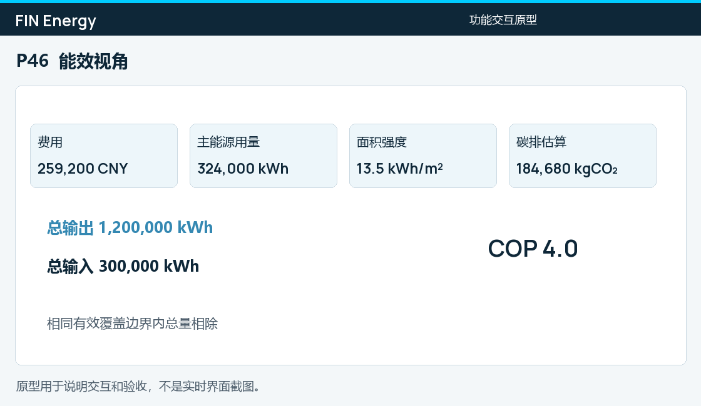

同边界总输出除以总输入。配置、完整性、单位和分母影响可计算状态。

**证据边界** 原0.14.37记录：C VA28/29。仅按该历史版本及场景理解；本次候选源码和受控测试记录另列，不整体升级为0.16实机通过。

## P47 计量平衡视角

EX-05 / AC 02,16,20

首页精简去向关联独立能流，计量面分列总分差额、覆盖和共享引用。

**证据边界** 原0.14.37记录：C VA30/31。仅按该历史版本及场景理解；本次候选源码和受控测试记录另列，不整体升级为0.16实机通过。

## P48 单站点自适应

EX-06 / AC 01,04

默认按当前真实可读 Site，保留真实层级和已关联设备。

**证据边界** 原0.14.37记录：C VA32; F1。仅按该历史版本及场景理解；本次候选源码和受控测试记录另列，不整体升级为0.16实机通过。

## P49 同项目多站点

EX-07 / AC 01,04,15

同一 FIN 项目的可读站点可并选或单选，按规范表计及计量边界统计。

**证据边界** 原0.14.37记录：C VA33。仅按该历史版本及场景理解；本次候选源码和受控测试记录另列，不整体升级为0.16实机通过。

## P50 首次启用与局部缺配置

EX-08 / AC 08,13,23

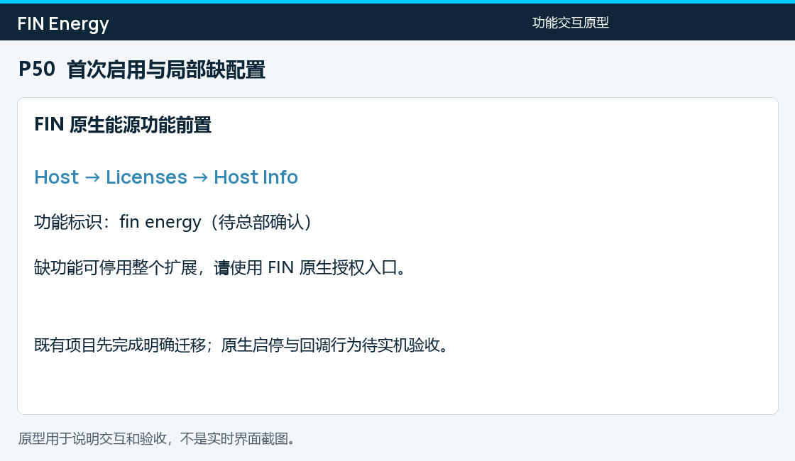

缺点位、历史、权限或能力按具体状态提示。可管理用户获得配置入口。

新增原生功能与迁移前置提示，不把整扩展停用视为普通局部缺项。

**证据边界** 原0.14.37记录：I。仅按该历史版本及场景理解；本次候选源码和受控测试记录另列，不整体升级为0.16实机通过。

## P51 模块失败及旧快照

EX-09 / AC 12,13

局部模块失败保留其他模块。请求级失败保留旧包及其标题和范围，允许显式刷新。

 整个扩展的授权不可用不属于普通模块降级，不能承诺其他模块仍可查询。

**证据边界** 原0.14.37记录：C VA36。仅按该历史版本及场景理解；本次候选源码和受控测试记录另列，不整体升级为0.16实机通过。

## P52 项目素材与热点

EX-10 / AC 23,34

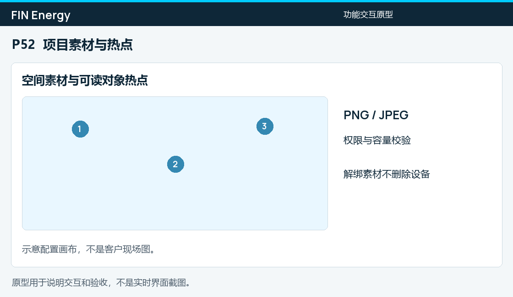

PNG/JPEG、容量与权限验证。热点关联可读空间。解绑和删除素材与业务设备分离。真实只读验收延期。

 迁移保留原ID，产品标签、结构化快照、报警及素材路径按原日志更新。 原生只读权限场景的旧待验项目仍需真实FIN核对。

**证据边界** 原0.14.37记录：C M4A01/03; D M4A02。仅按该历史版本及场景理解；本次候选源码和受控测试记录另列，不整体升级为0.16实机通过。

## P53 320 像素手机布局

EX-11 / AC 25

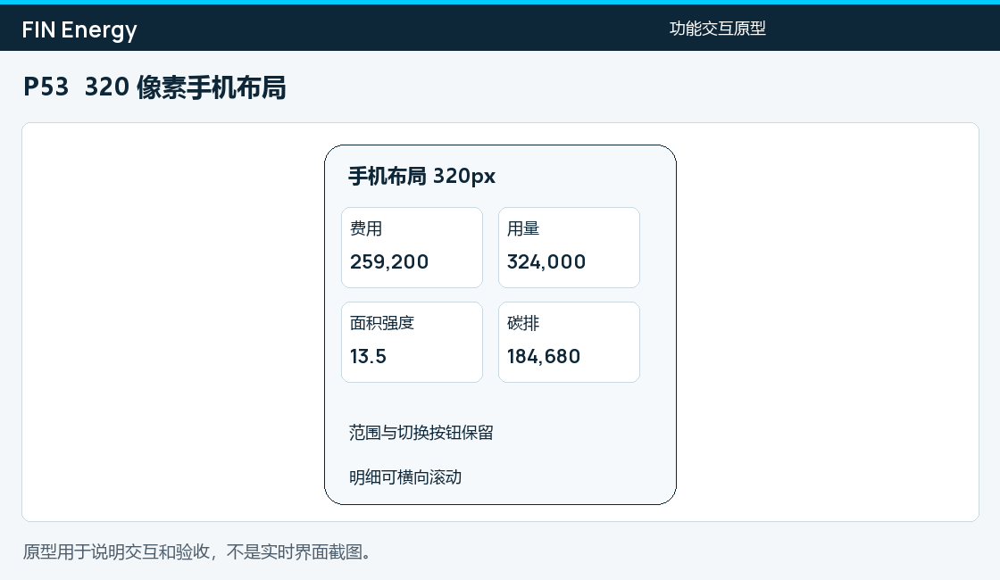

窄屏受控覆盖保留成对指标、按钮和可滚动明细。源版验收记录明确对应尺寸。

**证据边界** 原0.14.37记录：C VA20。仅按该历史版本及场景理解；本次候选源码和受控测试记录另列，不整体升级为0.16实机通过。

## P54 小时阈值与事件合并

EX-12 / AC 09,21

以能源单位的完整小时用量判断，需启用、阈值、有效历史及扫描。持续超限小时合并。

**证据边界** 原0.14.37记录：I。仅按该历史版本及场景理解；本次候选源码和受控测试记录另列，不整体升级为0.16实机通过。

## P55 清洗方案与异常处理

EX-13 / AC 17,18,19

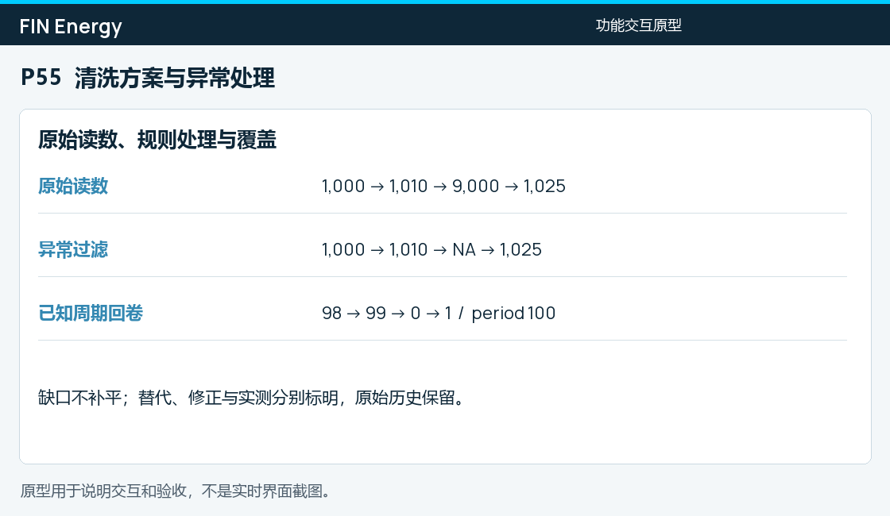

读取时按方案过滤、指定值或 NA 替代、已知周期回卷。保留原始历史和规则诊断。

原始历史保留；原生授权停用后的普通/raw历史及 hisFunc 可用性仍待真实FIN验收。

**证据边界** 原0.14.37记录：I。仅按该历史版本及场景理解；本次候选源码和受控测试记录另列，不整体升级为0.16实机通过。

## 原生授权与升级验收附录

总部确认准确功能键并提供真实许可证后，在隔离FIN验证有效/缺失/到期/重启与多项目，核对普通/raw历史及清洗回调。既有项目先预览、应用已审阅修订、检查原日志和持久维护状态；续作/回滚保留当前值与报警确认。最后对照相同范围、主点、时间和清洗条件的用量、分项、费用和差额，确认任务唯一。免费10表和培训授权仍为建议。
